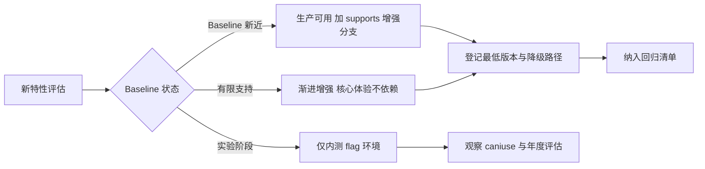

## CSS-199：如何跟进 CSS 新特性（风险矩阵与升级策略）？

**答**：
- 三档风险：Baseline 已就绪（生产可用）、有限支持（渐进增强分支）、实验阶段（flag 环境）——每个特性先归档再使用。
- 信息源：web.dev Baseline、caniuse、Chrome/WebKit 发布说明；工程侧用 browserslist 锁定目标，特性可用性由 @supports 运行时兜底。
- 升级策略：低风险直接用；中风险加增强分支并验证降级；高风险放内测开关后面，观察两个大版本再评估。
- 收尾动作：每个引入的新特性登记“最低支持版本与降级路径”，进回归清单。



```css
/* 低风险：Baseline 已就绪，直接使用 */
:has(.selected) { outline: 1px solid var(--brand); }

/* 中风险：增强分支 + 基线保底 */
.container-card { display: block; }
@supports (container-type: inline-size) {
  .container-card { container-type: inline-size; }
  @container (min-width: 400px) {
    .container-card .body { columns: 2; }
  }
}

/* 高风险：实验特性，开关控制 + @supports 双保险 */
.experimental-scroll { scroll-timeline: --page block; }
@supports (animation-timeline: --page) {
  .experimental-scroll .bar { animation-timeline: --page; }
}
/* 使用前提：产品开关 experimentalCss 打开才渲染该 DOM */
```
