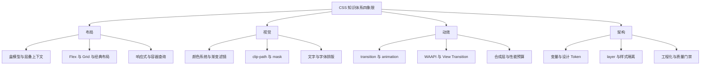

## CSS-200：CSS 知识体系如何收束成“布局 / 视觉 / 动效 / 架构”四象限？

**答**：
- 布局象限：盒模型 → 层叠上下文 → Flex/Grid → 响应式与容器查询，答题链路自底向上。
- 视觉象限：颜色系统 → 渐变/滤镜/混合 → clip-path/mask → 文字排版。
- 动效象限：transition/animation → WAAPI/View Transition → 合成层与性能预算。
- 架构象限：token → 命名 → @layer/隔离 → 工具链与质量门禁；四象限互为支撑，面试答题先定位象限再展开。



```css
/* 四象限速查卡：每象限一个代表性代码锚点 */
/* 布局象限 */
.layout-key {
  display: grid;
  grid-template-columns: repeat(auto-fit, minmax(200px, 1fr));
}
/* 视觉象限 */
.visual-key {
  background: linear-gradient(to right, var(--c1), var(--c2));
  clip-path: inset(0 round 12px);
}
/* 动效象限 */
.motion-key { transition: transform .2s ease, opacity .2s ease; }
/* 架构象限 */
.arch-key { --token-first: design-decision; }
```
