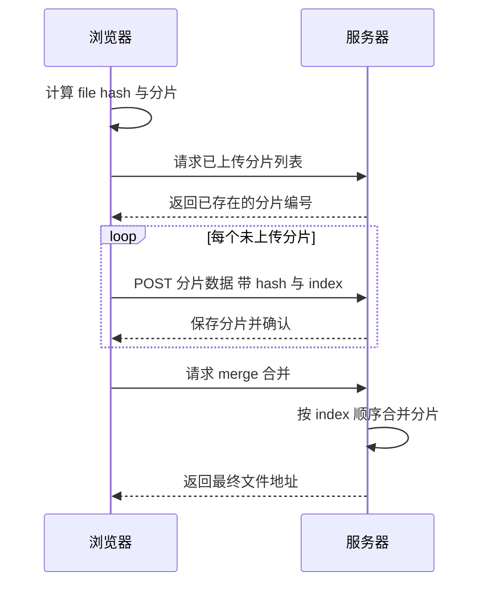

## H5-033：如何实现大文件分片上传与断点续传？
**答**：
- 思路：`file.slice` 切片 → 逐片（并发受限）上传 → 服务端按 hash 合并；文件整体 hash（如 md5）作为唯一标识。
- 断点续传：上传前先问服务端"这个 hash 已有哪些分片"，跳过已传的；失败只重传该片。
- 并发控制：同时传 3~6 片，配合进度回调；全部完成后调 merge 接口。
- 计算 hash 可能很慢，用 Web Worker 或抽样 hash（首尾 + 中间采样）权衡。



```javascript
// 分片上传核心实现：并发受限 + 跳过已传分片
async function uploadLarge(file, { chunkSize = 5 * 1024 * 1024, concurrency = 3 } = {}) {
  const hash = await calcHash(file); // 略：Worker 里算 md5

  // 1. 询问服务端已有分片，实现断点续传
  const res = await fetch(`/api/upload/status?hash=${hash}`);
  const { uploaded = [] } = await res.json();
  const uploadedSet = new Set(uploaded);

  const total = Math.ceil(file.size / chunkSize);
  const pending = [];
  for (let i = 0; i < total; i++) {
    if (!uploadedSet.has(i)) pending.push(i);
  }

  // 2. 并发受限地上传每个分片
  let cursor = 0;
  async function worker() {
    while (cursor < pending.length) {
      const index = pending[cursor++];
      const start = index * chunkSize;
      const blob = file.slice(start, start + chunkSize);
      const fd = new FormData();
      fd.append('chunk', blob);
      fd.append('hash', hash);
      fd.append('index', String(index));
      await fetch('/api/upload/chunk', { method: 'POST', body: fd });
      reportProgress(++done, total); // done 为外部计数器
    }
  }
  let done = uploadedSet.size;
  await Promise.all(Array.from({ length: concurrency }, worker));

  // 3. 通知合并
  await fetch('/api/upload/merge', {
    method: 'POST',
    headers: { 'Content-Type': 'application/json' },
    body: JSON.stringify({ hash, total, filename: file.name }),
  });
}
```

## 七、设备与系统 API
