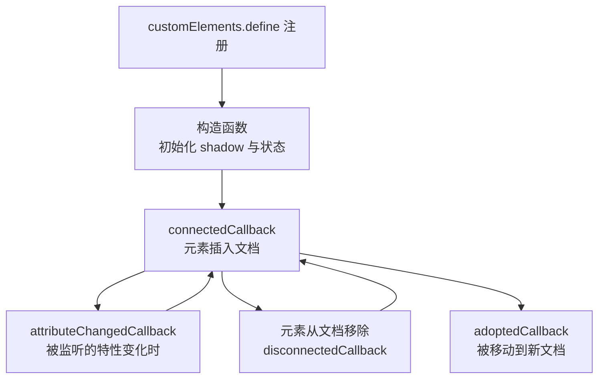

## H5-038：自定义元素的生命周期有哪些回调？
**答**：
- `connectedCallback`：插入 DOM 时（可多次触发）；`disconnectedCallback`：移除时；`adoptedCallback`：换文档时。
- `attributeChangedCallback(name, old, new)`：仅监听 `observedAttributes` 里声明的特性，且在 connected 之前就可能触发，注意判空。
- 自定义元素名必须含连字符（如 `my-button`），构造函数里不要访问属性/子元素（此时可能还没解析）。
- DOM 解析顺序问题：脚本先于子元素解析执行时，用 `defer` 或在 connectedCallback 里再读 children。



```javascript
// 完整生命周期演示
class CountDown extends HTMLElement {
  static observedAttributes = ['seconds', 'running']; // 只有这里列出的特性才触发回调

  constructor() {
    super();
    this.timer = null;
    console.log('constructor: 只做状态初始化，此处还没有子元素');
  }

  connectedCallback() {
    console.log('connected: 可以安全访问 this.children');
    this.seconds = Number(this.getAttribute('seconds') || 60);
    this.render();
    this.start();
  }

  disconnectedCallback() {
    console.log('disconnected: 清理定时器，防内存泄漏');
    clearInterval(this.timer);
  }

  attributeChangedCallback(name, oldVal, newVal) {
    console.log(`attribute changed: ${name} ${oldVal} -> ${newVal}`);
    if (name === 'seconds' && this.isConnected) {
      this.seconds = Number(newVal);
      this.render();
    }
  }

  start() {
    this.timer = setInterval(() => {
      this.seconds -= 1;
      this.render();
      if (this.seconds <= 0) clearInterval(this.timer);
    }, 1000);
  }

  render() {
    this.textContent = `剩余 ${this.seconds} 秒`;
  }
}

customElements.define('count-down', CountDown);
```

```html
<!-- 使用：改特性会触发 attributeChangedCallback -->
<count-down seconds="10" running></count-down>
```
