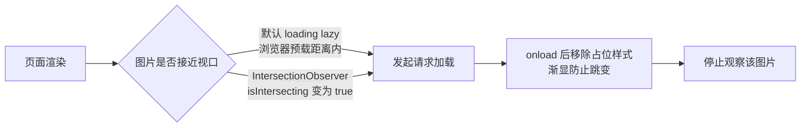

## H5-044：图片懒加载怎么做？原生 loading 与 IntersectionObserver 的差别？
**答**：
- 原生方案：`loading="lazy"`，浏览器自己判断接近视口才加载，零 JS；进入视口前会留出预载距离。
- IntersectionObserver：手动把真实 src 换成占位，交叉时再赋值，控制力强（可加渐显动画、自定义 rootMargin）。
- 兜底：不支持原生的环境降级 IO 方案；图片必须写 width/height 或 aspect-ratio 防 CLS。
- 首屏图不要懒加载（反而慢 LCP），只对首屏外内容启用。



```html
<!-- 原生懒加载：一行搞定，适合大多数列表图 -->


<!-- 首屏 LCP 图片：明确不要懒，并提升优先级 -->

```

```javascript
// IntersectionObserver 手动懒加载（含不支持 loading=lazy 的兜底）
function lazyLoadImages(selector = 'img[data-src]') {
  const io = new IntersectionObserver(
    (entries) => {
      for (const entry of entries) {
        if (!entry.isIntersecting) continue;
        const img = entry.target;
        img.src = img.dataset.src; // 真实地址此时才加载
        img.addEventListener('load', () => img.classList.add('loaded'), { once: true });
        io.unobserve(img); // 加载后停止观察
      }
    },
    { rootMargin: '200px' } // 提前 200px 预载，抵消网络延迟
  );
  document.querySelectorAll(selector).forEach((img) => io.observe(img));
  return io;
}

// CSS：占位背景 + 渐显，减少布局跳动感
// img[data-src] { background: #eee; opacity: 0; }
// img.loaded { opacity: 1; transition: opacity 0.3s; }

// 特性检测决定走哪条路
if ('loading' in HTMLImageElement.prototype) {
  document.querySelectorAll('img[data-src]').forEach((img) => {
    img.src = img.dataset.src;
    img.loading = 'lazy';
  });
} else {
  lazyLoadImages();
}
```
