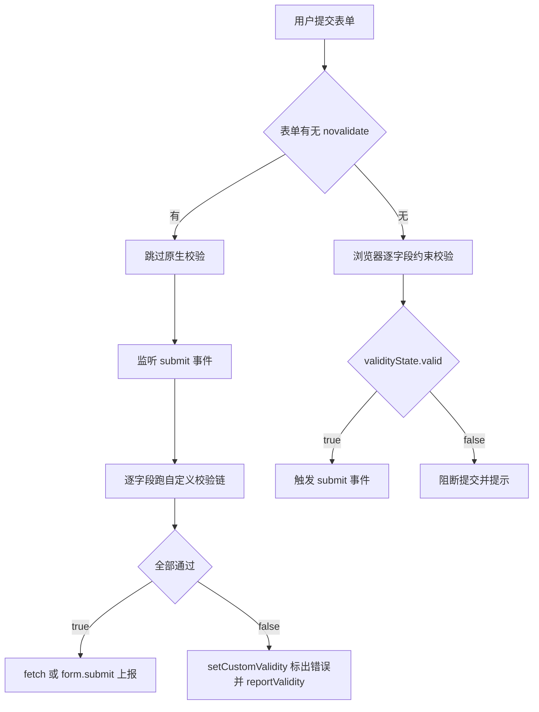

## H5-057：template 元素有哪些"深层"用法？和直接字符串拼 HTML 差在哪？
**答**：
- `template` 内容**惰性**：不渲染、不执行内部脚本、不发图片请求、样式不生效，直到被 clone 进文档。
- 解析阶段已完成：`content` 里是现成的 DOM 子树，比 `innerHTML` 拼字符串多一道 XSS 防线（没有动态拼串），且无需二次 parse。
- 可作为"组件的静态外壳"：Web Components 在构造/连接时 clone 模板注入 shadow DOM，是 H5-040 之外更工程化的模式。
- 模板可放在任意位置复用（表格行、列表项），`content` 支持一次性 `importNode` 或多次 `cloneNode(true)`。
- 注意点：template 内无法使用文档级相对 URL 解析；全局事件委托抓不到未实例化的模板内容。

```html
<template id="row-tpl">
  <tr>
    <td class="name"></td>
    <td class="price"></td>
  </tr>
</template>
<table id="goods"><tbody></tbody></table>

<script>
  const tpl = document.getElementById('row-tpl');
  const tbody = document.querySelector('#goods tbody');

  const data = [
    { name: '键盘', price: '¥299' },
    { name: '鼠标', price: '¥199' },
  ];

  // 关键差异：innerHTML 需要 parse 且有注入风险，template 是现成 DOM，赋值即可
  for (const item of data) {
    const frag = tpl.content.cloneNode(true);      // 深克隆，模板本体不动
    frag.querySelector('.name').textContent = item.name;   // textContent 防注入
    frag.querySelector('.price').textContent = item.price;
    tbody.appendChild(frag);
  }

  // 惰性验证：模板里的脚本与图片在克隆进文档前绝不执行/请求
  console.log(tpl.content.childElementCount); // 结构完整可用
</script>
```

## 十二、表单进阶


