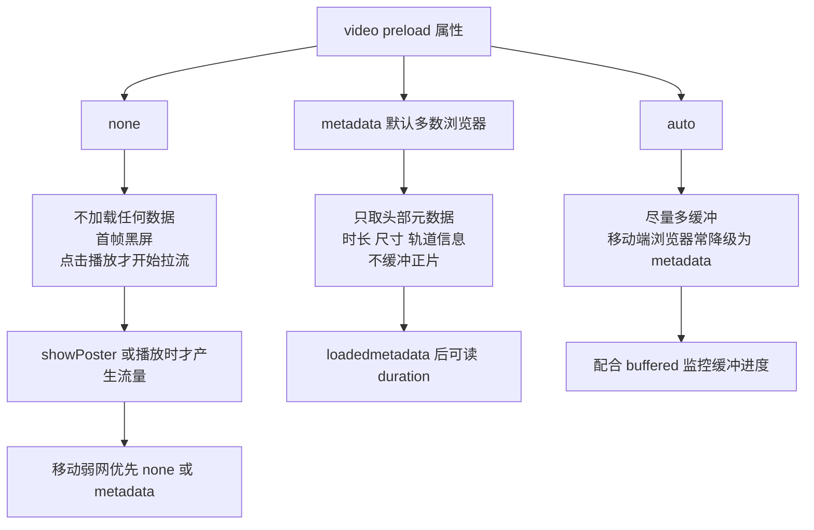

## H5-064：inputmode 与 enterkeyhint 如何定制移动端虚拟键盘？
**答**：
- `inputmode` **只改键盘布局，不改校验与语义**——这是它与 `type` 的本质区别：`type="text" inputmode="numeric"` 得到数字键盘但值仍是字符串。
- 常用值：`numeric`（纯数字）、`decimal`（带小数点）、`tel`、`email`、`url`、`search`；`none` 可隐藏软键盘（自定义键盘场景）。
- 典型痛点：验证码输入用 `type="text" inputmode="numeric"`，既有数字键盘又允许中途粘贴带空格的值。
- `enterkeyhint` 定制回车键文案：`enter/done/go/next/search/send`，引导用户下一步动作。
- 二者都是渐进增强：不支持的浏览器安全忽略；桌面端无感，移动端体验质变。

```html
<form>
  <!-- 验证码：数字键盘 + 发送键 -->
  <label>验证码
    <input name="code" type="text" inputmode="numeric"
           pattern="\d{6}" maxlength="6" autocomplete="one-time-code"
           enterkeyhint="done">
  </label>

  <!-- 金额：允许小数点，回车显示"下一步" -->
  <label>充值金额
    <input name="amount" type="text" inputmode="decimal"
           enterkeyhint="next">
  </label>

  <!-- 站内搜索框：搜索键盘 + 搜索键 -->
  <label>搜索
    <input name="q" type="search" inputmode="search" enterkeyhint="search">
  </label>

  <!-- 链接粘贴：URL 键盘自带斜杠与 .com -->
  <label>主页
    <input name="url" type="text" inputmode="url" enterkeyhint="go">
  </label>

  <button>提交</button>
</form>

<script>
  // type 与 inputmode 语义分离的体现：value 始终是字符串
  document.querySelector('form').addEventListener('submit', (e) => {
    e.preventDefault();
    const code = e.target.elements.code.value;   // "123456" 字符串
    console.log(code, typeof code);
  });
</script>
```

## 十三、媒体进阶


