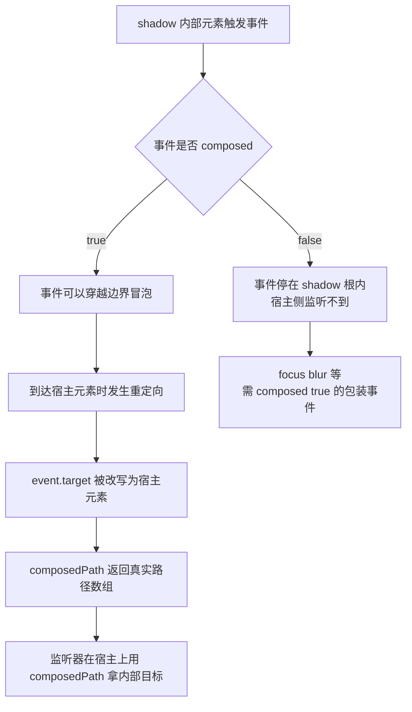

## H5-097：Gamepad API 如何接入手柄？轮询模型为什么不能靠事件？
**答**：
- 接入两步：`window.addEventListener('gamepadconnected')` 拿到索引 → 每帧 `navigator.getGamepads()[index]` **主动轮询**状态。
- 必须轮询的原因：按键/摇杆是**持续状态**（按住、推到一半），不是离散事件；浏览器只在连接/断开时派发事件，输入变化不派发。
- 数据结构：`buttons[i].pressed/value`（数字键支持压力值），`axes[0..3]` 摇杆模拟量（-1~1），带死区处理。
- 用户必须**先按键唤醒**手柄才会触发 connected；页面需获得焦点；无线手柄休眠后 disconnected 再 connected。
- 摇杆死区：`|v| < 0.12` 视为 0，否则旧手柄漂移会自走。

```javascript
class GamepadInput {
  constructor() {
    this.index = null;
    window.addEventListener('gamepadconnected', (e) => {
      this.index = e.gamepad.index;
      console.log('手柄已连接：', e.gamepad.id);
    });
    window.addEventListener('gamepaddisconnected', (e) => {
      if (e.gamepad.index === this.index) this.index = null;
    });
  }

  poll() {
    if (this.index === null) return;
    const gp = navigator.getGamepads()[this.index];
    if (!gp) return;

    // 左摇杆 + 死区
    const dead = 0.12;
    const ax = Math.abs(gp.axes[0]) < dead ? 0 : gp.axes[0];
    const ay = Math.abs(gp.axes[1]) < dead ? 0 : gp.axes[1];

    // 按键：A 跳、B 冲刺、Start 暂停
    if (gp.buttons[0].pressed) this.onJump?.();
    if (gp.buttons[1].value > 0.5) this.onSprint?.();   // 压力值做"轻按/重按"
    if (gp.buttons[9].pressed) this.onPause?.();

    this.onMove?.(ax, ay);
  }
}

const input = new GamepadInput();
input.onJump = () => player.jump();

// 主循环里每帧轮询（与渲染 rAF 合流）
function loop() {
  input.poll();
  render();
  requestAnimationFrame(loop);
}
requestAnimationFrame(loop);
```

## 十八、Web Components 深入


