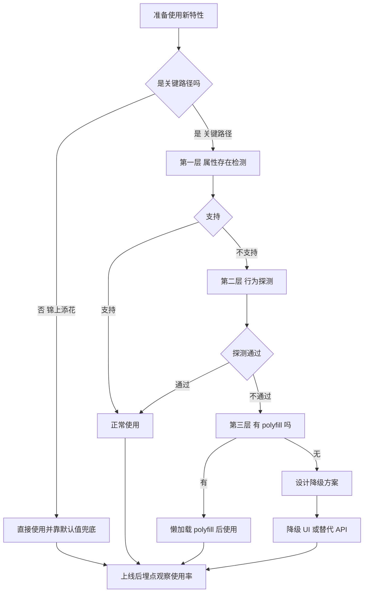

## H5-125：HTML5 特性检测的"万能模式"与 polyfill 策略如何收束？
**答**：
- 四层检测顺序：**属性存在**（`'popover' in HTMLElement.prototype`）→ **构造器/方法存在**（`window.PaymentRequest`）→ **行为探测**（`canMakePayment()`、建一个 canvas 试 `getContext('webgl')`）→ **能力参数校验**（`canShare({files})`）。
- 永远检测"能力"而不是"浏览器名"：UA 嗅探只保留给"修特定浏览器 bug"的最后手段。
- polyfill 策略分级：**语法类**（ES 特性）交给 core-js/babel；**API 类**优先按需引入官方 polyfill（loading=lazy、dialog、popover、structuredClone）；**不可 polyfill 的**（MSE、WebTransport、USB 硬件）只能渐进增强 + 降级 UI。
- 引入方式：`<script nomodule>`/动态 import 按 feature flag 加载，polyfill 也应懒加载，别为 1% 用户拖慢 99% 首屏。
- 收束心法：新特性先问"不支持时页面还能用吗"——答案决定它是"锦上添花直接用"还是"关键路径需要检测+降级+polyfill"。



```javascript
// 万能检测工具：按层级封装
const support = {
  // 第一层：属性存在
  hasPopover: 'popover' in HTMLElement.prototype,
  hasDialog: typeof HTMLDialogElement === 'function',

  // 第二层：构造器 + 方法探测
  async payment() {
    if (!window.PaymentRequest) return false;
    try {
      const req = new PaymentRequest(
        [{ supportedMethods: 'basic-card' }],
        { total: { label: 't', amount: { currency: 'CNY', value: '0.01' } } }
      );
      return await req.canMakePayment();       // 行为级：有可用支付方式才算
    } catch { return false; }
  },

  // 第三层：能力参数校验
  canShareFiles(files) { return navigator.canShare?.({ files }) ?? false; },
};

// polyfill 懒加载：仅在需要时动态 import
async function ensurePopover() {
  if (support.hasPopover) return;
  await import('@oddbird/popover-polyfill');   // 官方推荐的按需 polyfill
}

// 不可 polyfill 的能力：渐进增强 + 降级
async function playStreaming(video, url) {
  if (window.MediaSource && MediaSource.isTypeSupported('video/mp4; codecs="avc1.64001f"')) {
    return msePlay(video, url);                // MSE 流式
  }
  if (video.canPlayType('application/vnd.apple.mpegurl')) {
    video.src = url.replace('.mp4', '.m3u8');  // iOS 原生 HLS
    return video.play();
  }
  video.src = url;                             // 最终降级：整文件直出
  return video.play();
}

// 反模式备忘：不要这样写
// const isChrome = /Chrome/.test(ua);         // UA 嗅探不可维护
// if (isChrome) enableShare();
```

## 二十一、Canvas 高级渲染
