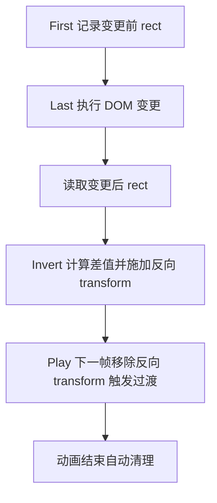

## H5-148：FLIP 动画技术是什么？如何完整实现？
**答**：
- FLIP = **First**（变更前记录位置）→ **Last**（执行 DOM 变更后取新位置）→ **Invert**（用 transform 反向平移缩放，使元素"看起来没动"）→ **Play**（下一帧移除反向 transform，触发过渡）。
- 解决的问题：DOM 重排（列表重排/过滤/树折叠）后元素位置突变，而 transition 只对"属性变化"生效、对"位置突变"无效。
- 实现用 `element.animate()` 比 transition 干净：首帧即反向、末帧归位，无需 rAF/transitionend 清理。
- 注意只动 transform/opacity 保证合成器执行；嵌套滚动容器中 rect 是视口坐标，父容器也在动时要把父级位移减掉。



```javascript
function flip(elements, mutate, duration = 300) {
  // First：变更前快照每个元素的位置
  const first = new Map(elements.map((el) => [el, el.getBoundingClientRect()]));
  mutate();                                   // Last：真正的 DOM 变更

  for (const el of elements) {
    const f = first.get(el);
    const l = el.getBoundingClientRect();     // Last 位置
    const dx = f.left - l.left;
    const dy = f.top - l.top;
    const sx = l.width ? f.width / l.width : 1;
    const sy = l.height ? f.height / l.height : 1;
    if (!dx && !dy && sx === 1 && sy === 1) continue;

    // Invert + Play：首帧从旧位置"看起来没动"，末帧自然归位
    el.animate(
      [
        {
          transformOrigin: '0 0',
          transform: `translate(${dx}px, ${dy}px) scale(${sx}, ${sy})`,
        },
        { transformOrigin: '0 0', transform: 'none' },
      ],
      { duration, easing: 'cubic-bezier(.22,1,.36,1)' }
    );
  }
}

// 用法：列表重排 / 过滤 / 折叠展开 —— 只要"DOM 变了但希望平滑过渡"都适用
const list = document.getElementById('list');
document.getElementById('shuffle').onclick = () =>
  flip([...list.children], () =>
    list.append(...[...list.children].sort(() => Math.random() - 0.5)));

// 坑 1：rect 是视口坐标，嵌套滚动容器里父级也在动时要把父级位移减掉
// 坑 2：只动 transform/opacity 才走合成器
// 坑 3：FLIP 期间禁用会干扰的 CSS transition，避免双重动画
```
