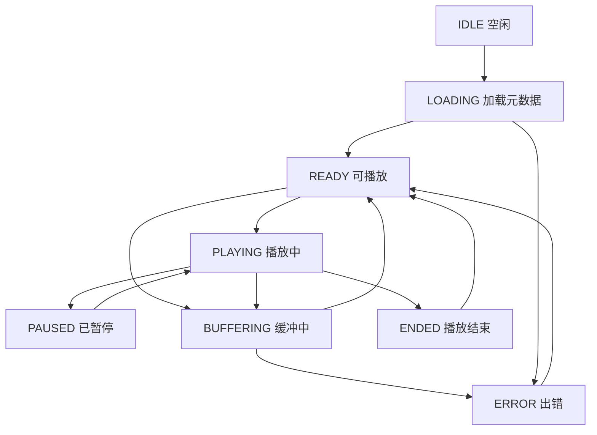

## H5-181：设计一个视频播放器组件（自定义控制条/全屏/快捷键/倍速）
**答**：
- 用原生事件驱动状态机：`waiting/playing/pause/ended/error` 映射 UI 状态（缓冲圈、播放键图标），不要自己发明状态。
- 控制条：进度条 input 时预览、落点才 seek（防高频 seek 卡顿）；`timeupdate` 更新时间与进度；倍速直接 `playbackRate`。
- 快捷键：空格播放暂停、←/→ 快退快进、F 全屏；先排除输入框焦点（`e.target.matches('input,...')`）。
- 全屏：容器 `requestFullscreen()`（控制条一起全屏），iOS Safari 降级 `video.webkitEnterFullscreen()`（元素级）；自动隐藏控制条：3s 无操作 + 播放中隐藏，hover/focus 恢复。



```html
<div class="player" id="player">
  <video id="v" src="movie.mp4" playsinline></video>
  <div class="controls">
    <button id="play">播放</button>
    <input id="seek" type="range" value="0" min="0" max="100" step="0.1">
    <span id="time">0:00</span>
    <select id="rate">
      <option>0.5</option><option selected>1</option>
      <option>1.5</option><option>2</option>
    </select>
    <button id="fs">全屏</button>
  </div>
</div>
<style>
  .controls { opacity: 0; transition: .2s; }
  .player:hover .controls, .player:focus-within .controls { opacity: 1; }
  .player.hide-cursor { cursor: none; }
  .player:fullscreen video { width: 100vw; height: calc(100vh - 48px); object-fit: contain; }
</style>
<script>
const player = document.getElementById('player');
const v = document.getElementById('v');
const fmt = (s) => `${Math.floor(s / 60)}:${String(Math.floor(s % 60)).padStart(2, '0')}`;

// 状态机见上图：原生事件驱动 UI 状态，不自造状态
v.addEventListener('waiting', () => player.classList.add('buffering'));   // 缓冲
v.addEventListener('playing', () => player.classList.remove('buffering'));
v.addEventListener('timeupdate', () => {
  seek.value = (v.currentTime / (v.duration || 1)) * 100;
  time.textContent = fmt(v.currentTime);
});
v.addEventListener('ended', () => (play.textContent = '重播'));

// 进度条：input 高频只预览，change/落点才 seek，防高频 seek 卡顿
seek.oninput = () => { seekDragging = true; };
seek.onchange = () => {
  v.currentTime = (seek.value / 100) * (v.duration || 0);
  seekDragging = false;
};
rate.onchange = () => (v.playbackRate = +rate.value);   // 倍速

// 快捷键：先排除输入框焦点
let seekDragging = false;
addEventListener('keydown', (e) => {
  if (e.target.matches('input,textarea,select')) return;
  if (e.code === 'Space') { e.preventDefault(); togglePlay(); }
  if (e.key === 'ArrowRight') v.currentTime += 5;
  if (e.key === 'ArrowLeft') v.currentTime -= 5;
  if (e.key.toLowerCase() === 'f') toggleFS();
});

const togglePlay = () => (v.paused ? v.play().catch(() => {}) : v.pause());
play.onclick = togglePlay;
function toggleFS() {
  if (document.fullscreenElement) return document.exitFullscreen();
  if (player.requestFullscreen) player.requestFullscreen();   // 容器全屏：控制条一起
  else v.webkitEnterFullscreen?.();     // iOS Safari 只有元素级全屏
}
fs.onclick = toggleFS;

// 自动隐藏控制条：播放中 3s 无操作隐藏
let hideTimer;
player.addEventListener('pointermove', () => {
  player.classList.remove('hide-cursor');
  clearTimeout(hideTimer);
  if (!v.paused) hideTimer = setTimeout(() => player.classList.add('hide-cursor'), 3000);
});
</script>
```
