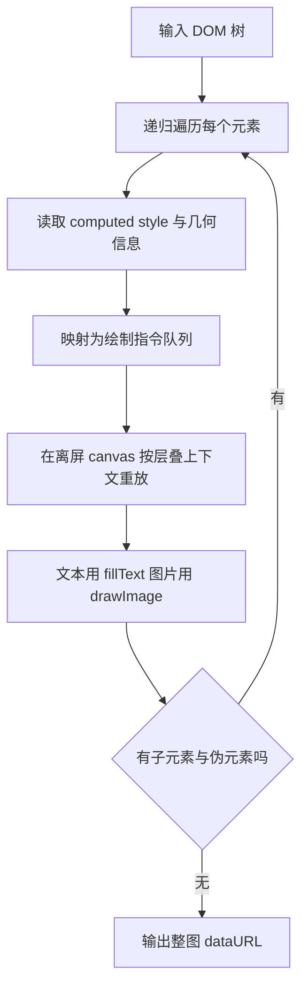

## H5-194：设计一个网页截屏工具（html2canvas 原理概览）
**答**：
- 原理一句话：**在浏览器渲染引擎之外，用 JS 重演渲染管线**——克隆 DOM → 逐元素读 computed style 与几何信息 → 映射成 Canvas 绘制指令 → 按层叠上下文排序重放到离屏 canvas。
- 核心资产是"CSS 属性 → Canvas 指令"映射表（背景/边框/圆角/阴影/文本 fillText/图片 drawImage）与**层叠上下文排序**（z-index/transform/opacity 创建新上下文）——还原度与性能的大头。
- 局限：跨域图片受 CORS 限制会空白、iframe 内容不可读、部分滤镜/混合模式不支持、外部字体必须已加载。
- 替代方案：dom-to-image（foreignObject 序列化，快但字体坑多）；保真度上限是服务端 Puppeteer 截图。



```javascript
// html2canvas 原理 = 用浏览器之外的方式重演渲染管线
// 1) 克隆：目标 DOM 克隆到同尺寸 iframe（隔离样式，避免页面样式污染）
// 2) 遍历：每个元素读 getComputedStyle + getBoundingClientRect
// 3) 翻译：CSS 属性 → Canvas 指令映射表（核心资产）
const PAINTERS = {
  'background-color': (ctx, v, box) => { ctx.fillStyle = v; ctx.fillRect(0, 0, box.w, box.h); },
  'border-radius': (ctx, v, box) => { roundRectPath(ctx, box, v); },
  'box-shadow': (ctx, v, box) => { /* 解析 shadow 语法后画模糊矩形 */ },
  color: (ctx, v, box, el) => {
    // 文本：逐文本节点按字体/基线 fillText（保证换行一致），不是读 innerText
    for (const line of layoutText(el))
      ctx.fillText(line.text, line.x, line.y);
  },
};
function layoutText() { return []; }
function roundRectPath() {}

// 4) 层叠上下文：按 stacking context 排序绘制（z-index/transform/opacity 创建新上下文）
//    —— 这是还原度的大头，也是 html2canvas 慢的原因
// 5) 图片资源：img/背景图重新请求并转 dataURL（受 CORS 限制，跨域图会空白）
// 6) 不支持：iframe 内容、部分滤镜/混合模式、未加载的外部字体

// 业务用法：
async function screenshot(el) {
  const canvas = await html2canvas(el, {
    scale: devicePixelRatio,
    useCORS: true,               // 跨域图走 CORS
    backgroundColor: '#ffffff',
    logging: false,
  });
  return canvas.toDataURL('image/png');
}
// 替代方案概览：
// dom-to-image：SVG foreignObject + 序列化 —— 更快但字体/跨域坑多
// 服务端 Puppeteer screenshot：保真度上限的选择（有服务端预算时优先）
```

## 追问（补充）

**追问**：

1. 为什么先把 DOM 克隆进同尺寸 iframe 再遍历？ → 隔离宿主页面的脚本与继承样式，避免伪元素、全局 CSS 污染 `getComputedStyle` 的测量结果，也方便固定视口宽度。
2. 跨域图片为什么会渲染空白，useCORS 做了什么？ → 未带 CORS 头的图片会污染 canvas 使 toDataURL 抛安全错误；useCORS 让图片带凭据请求，服务端需配合返回 Access-Control-Allow-Origin。
3. 文本为什么必须按行 fillText 而不是整段填 innerText？ → Canvas 没有自动换行，必须按字体度量自己断行、对齐基线，否则换行位置与浏览器不一致，还原度立刻崩。
