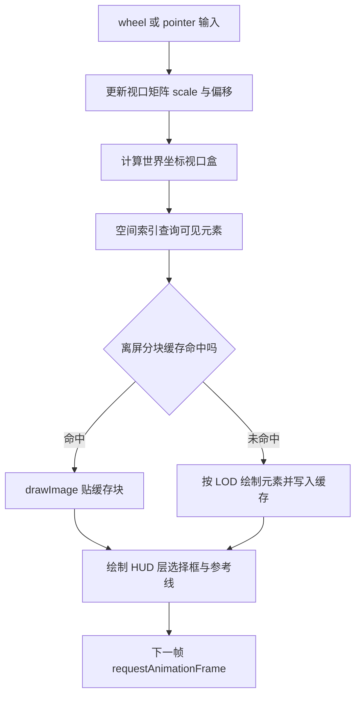

## H5-195：设计一个无限画布（Figma 式视口/渲染 culling）
**答**：
- 视口模型：`{scale, x, y}` 矩阵 + 世界/屏幕坐标互转（H5-135）；缩放以鼠标为不动点，平移直接改偏移，输入用 Pointer Events + wheel。
- 渲染 culling：世界坐标视口盒 → 网格哈希/四叉树查询可见元素 → 只画可见集；缩放小时 LOD 降级（文本只画色块，再小只画包围盒）。
- "无限"的本质是**重绘成本恒定**：静态内容按 256px 世界块分块缓存（tile），任何块只在内容变化时失效重绘，平移时 drawImage 拼块。
- 分层：内容层（世界系）+ HUD 层（屏幕系：选择框/参考线/小地图）；一帧内多次输入合并到 rAF 渲染。



```javascript
// Figma 式无限画布：视口矩阵 + 空间索引 + culling + 分块缓存
const viewport = { scale: 1, x: 0, y: 0 };
const toWorld = (sx, sy) => ({ x: (sx - viewport.x) / viewport.scale,
                               y: (sy - viewport.y) / viewport.scale });
const index = new GridIndex(256);            // 网格哈希，见 H5-138

// 1) 平移：直接改偏移；缩放不动点见 H5-135
let pan = null;
canvas.addEventListener('pointerdown', (e) => {
  if (e.button === 1 || spaceHeld) pan = { x: e.clientX, y: e.clientY };
});
canvas.addEventListener('pointermove', (e) => {
  if (!pan) return;
  viewport.x += e.clientX - pan.x;
  viewport.y += e.clientY - pan.y;
  pan = { x: e.clientX, y: e.clientY };
  scheduleFrame();                           // 合帧：一帧最多渲染一次
});
addEventListener('pointerup', () => (pan = null));

// 2) 渲染：视口盒 → 索引查询 → 只画可见 + LOD
const dpr = devicePixelRatio || 1;
function render(ctx) {
  ctx.setTransform(dpr * viewport.scale, 0, 0, dpr * viewport.scale,
                   dpr * viewport.x, dpr * viewport.y);
  const w0 = toWorld(0, 0), w1 = toWorld(canvas.clientWidth, canvas.clientHeight);
  for (const el of index.query(w0.x, w0.y, w1.x, w1.y)) {
    drawEl(ctx, el, viewport.scale);         // LOD：scale 小时降级细节
  }
  ctx.setTransform(dpr, 0, 0, dpr, 0, 0);    // HUD 层：屏幕系（选择框/参考线/小地图）
  drawHUD(ctx);
}

// 3) 分块缓存：静态内容按 256px 世界块预渲染 —— "无限"的关键，重绘成本恒定
const TILE = 256;
const tiles = new Map();                     // key "bx,by" -> canvas
function drawTiles(ctx) {
  const [bx0, by0, bx1, by1] = visibleTileRange();
  for (let bx = bx0; bx <= bx1; bx++)
    for (let by = by0; by <= by1; by++) {
      const k = bx + ',' + by;
      if (!tiles.has(k)) tiles.set(k, buildTile(bx, by));   // 块只在内容变化时失效
      ctx.drawImage(tiles.get(k), bx * TILE, by * TILE);
    }
}
function visibleTileRange() { return [0, 0, 4, 3]; }
function buildTile(bx, by) { return document.createElement('canvas'); }
function drawEl() {}
function drawHUD() {}
function scheduleFrame() { /* rAF 合帧渲染 */ }
const spaceHeld = false;

// 4) 编辑状态细节对齐 Figma：空格平移、滚轮缩放、拾取两级检测（粗筛+精确）；
// 5) 数据量极大时 tile 服务端化/按视口预取，前端只保留窗口附近块
```
