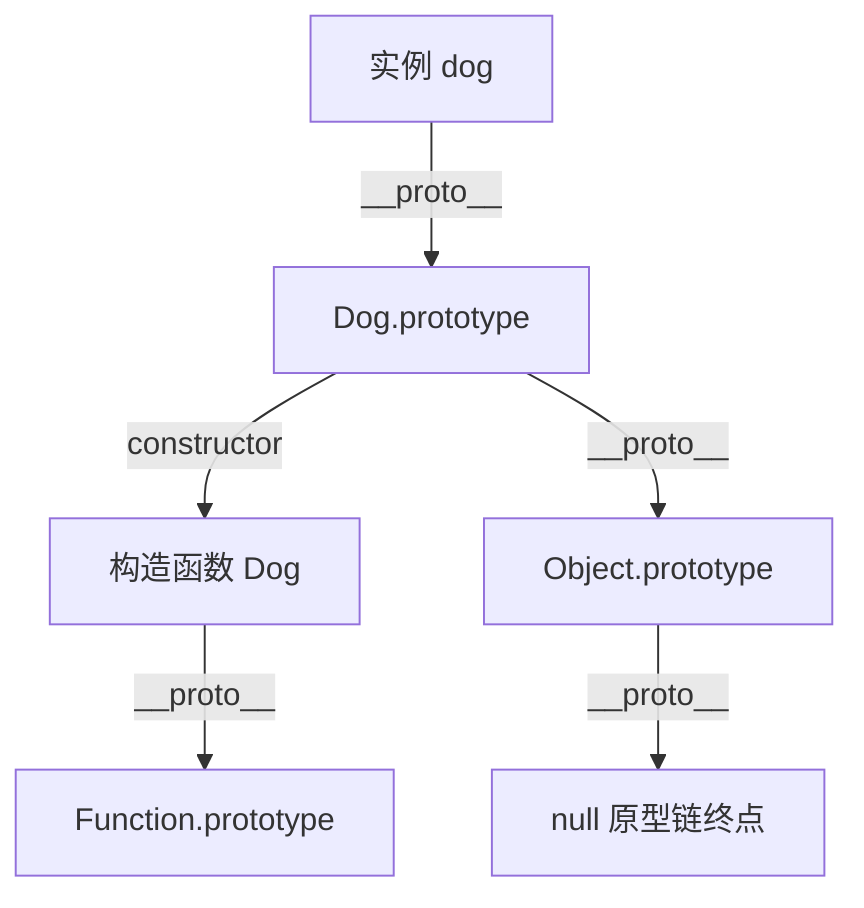

## JS-026：什么是原型和原型链？

**答**：
- 每个函数都有 `prototype`（原型对象），内部含 constructor 指回函数。
- 每个对象都有 `[[Prototype]]`（可用 `__proto__`/`Object.getPrototypeOf` 访问）。
- 属性查找沿 `[[Prototype]]` 一路向上直到 null，这条链就是原型链。
- 对象自己的属性遮蔽原型上的同名属性；`__proto__` 已废弃，工程代码用 Object.create / setPrototypeOf。



```javascript
function Dog(name) { this.name = name; }
Dog.prototype.bark = function () { return `${this.name}: woof`; };

const d = new Dog('旺财');
console.log(d.__proto__ === Dog.prototype);              // true
console.log(Dog.prototype.constructor === Dog);          // true
console.log(d.toString.__proto__ === Function.prototype);// 沿链向上

console.log(d.hasOwnProperty('name')); // true，自身属性
console.log(d.hasOwnProperty('bark')); // false，在原型上
```
