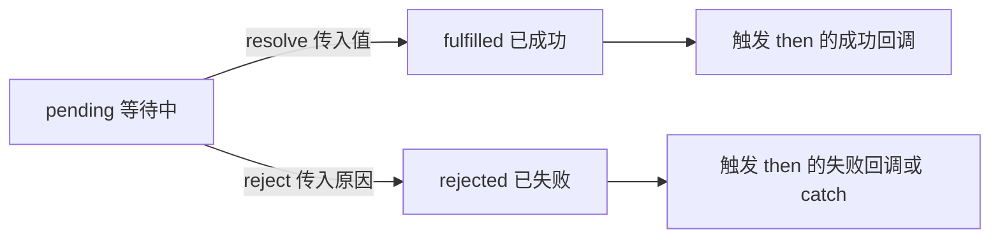

## JS-034：Promise 解决了什么问题？有哪三种状态？

**答**：
- 解决回调地狱：把嵌套回调改为链式 then，错误统一走 catch。
- 三种状态：pending → fulfilled（有值）或 rejected（有原因），状态一旦改变不可逆。
- Promise 构造函数同步执行，resolve/reject 决定后续 then 走哪个分支。
- 一个 Promise 只能被改变一次，重复 resolve 无效。



```javascript
function loadImage(src) {
  return new Promise((resolve, reject) => {
    const img = new Image();
    img.onload = () => resolve(img);
    img.onerror = () => reject(new Error(`load failed: ${src}`));
    img.src = src;
  });
}

loadImage('/a.png')
  .then((img) => console.log('loaded', img.width))
  .catch((err) => console.error(err.message))
  .finally(() => console.log('done')); // 无论成败都执行

const p = new Promise((resolve) => {
  resolve(1);
  resolve(2); // 无效，状态已凝固
});
```
