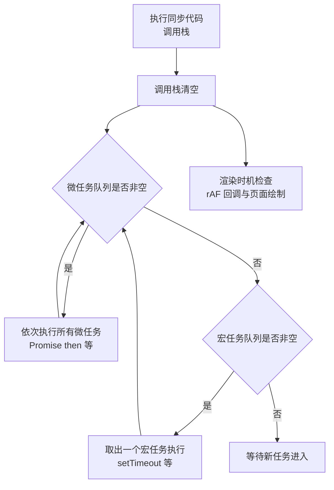

## JS-043：浏览器的事件循环机制是怎样的？

**答**：
- JS 单线程，同步任务在调用栈执行；异步任务完成后其回调进入任务队列。
- 每轮循环：执行完调用栈 → 清空**全部微任务** → 渲染检查（rAF、样式布局、paint）→ 取**一个宏任务**执行，如此往复。
- 微任务包括 Promise.then、MutationObserver、queueMicrotask。
- 宏任务包括 setTimeout/setInterval、I/O、UI 事件、script 整体代码。



```javascript
console.log('1');
setTimeout(() => console.log('2'), 0);
Promise.resolve().then(() => console.log('3'));
queueMicrotask(() => console.log('4'));
console.log('5');
// 输出：1 5 3 4 2 —— 微任务优先于宏任务
```
