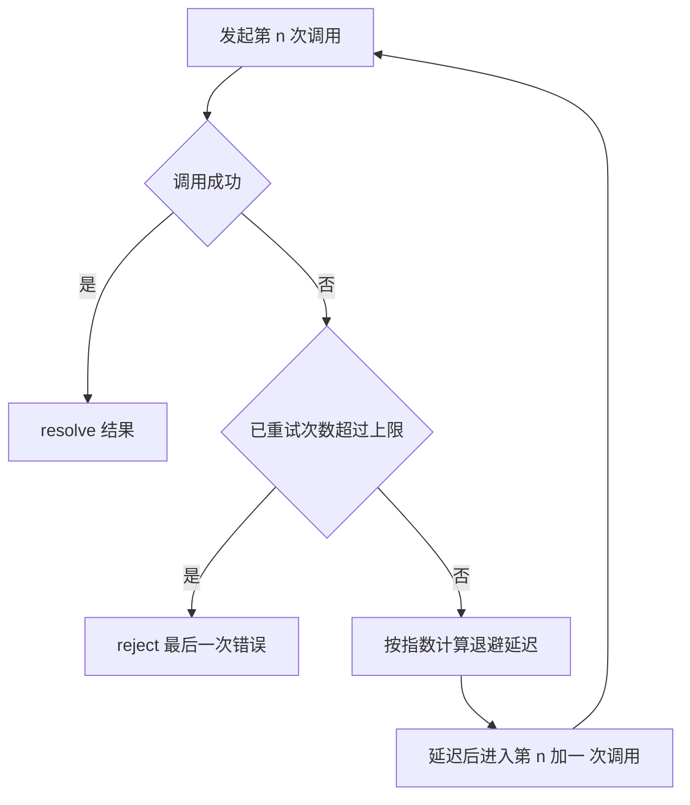

## JS-083：如何手写 Promise.retry？指数退避怎么实现？

**答**：
- 核心结构：失败后 `setTimeout(run, delay)` 递归重试，成功或次数耗尽才终结。
- 指数退避：`delay = base * factor^(attempt-1)`，配合上限 maxDelay 防止无限增长。
- 生产建议：只对幂等/瞬时故障（网络抖动、限流）重试，业务错误直接抛出。
- 高级做法是“指数退避 + 抖动”（加随机量），避免大量客户端同时重试造成雪崩。



```javascript
function retry(task, { retries = 3, base = 200, factor = 2, maxDelay = 5000 } = {}) {
  return new Promise((resolve, reject) => {
    let attempt = 0;
    const run = () => {
      Promise.resolve()
        .then(task)
        .then(resolve)
        .catch((err) => {
          if (++attempt > retries) return reject(err); // 次数耗尽，抛最后一次错误
          const jitter = Math.random() * 100;           // 抖动：错开重试时间
          const delay = Math.min(base * factor ** (attempt - 1), maxDelay) + jitter;
          console.log(`第 ${attempt} 次失败，${Math.round(delay)}ms 后重试`);
          setTimeout(run, delay);
        });
    };
    run();
  });
}

let calls = 0;
const flaky = () => {
  if (++calls < 3) return Promise.reject(new Error('network glitch'));
  return Promise.resolve('ok after retry');
};
retry(flaky, { retries: 5, base: 100 }).then(console.log); // ok after retry
```
