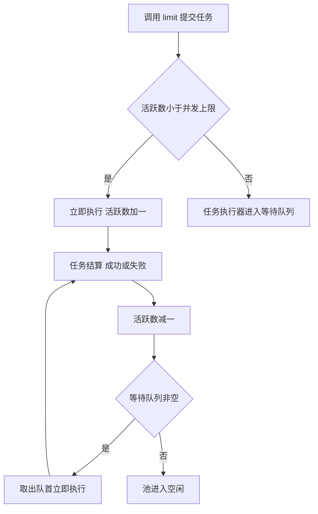

## JS-090：如何实现 async 并发限制器（p-limit）？

**答**：
- 核心状态：活跃数 activeCount、等待队列 queue、并发上限 concurrency。
- 提交任务：未达上限立即执行并 activeCount++；否则入队等待。
- 任务结算：无论成败都 activeCount-- 并从队首取下一个任务，保证槽位不泄漏。
- 返回值语义：limit(fn) 返回的 Promise 就是该任务本身的 Promise，可直接进 Promise.all。



```javascript
function pLimit(concurrency) {
  if (!Number.isInteger(concurrency) || concurrency < 1) {
    throw new TypeError('concurrency 必须是正整数');
  }
  let activeCount = 0;
  const queue = [];

  const next = () => {
    activeCount -= 1;
    if (queue.length > 0) queue.shift()();
  };

  const run = (fn, resolve, reject) => {
    activeCount += 1;
    fn().then(resolve, reject).then(next); // 结算后释放槽位
  };

  return function limit(fn) {
    return new Promise((resolve, reject) => {
      const start = () => run(fn, resolve, reject);
      if (activeCount < concurrency) start();
      else queue.push(start);
    });
  };
}

const limit = pLimit(2);
const task = (id) => () =>
  new Promise((r) => setTimeout(() => {
    console.log('done', id);
    r(id);
  }, 100));

(async () => {
  const results = await Promise.all([1, 2, 3, 4, 5].map((i) => limit(task(i))));
  console.log('all', results); // done 输出永远两个一组
})();
```
