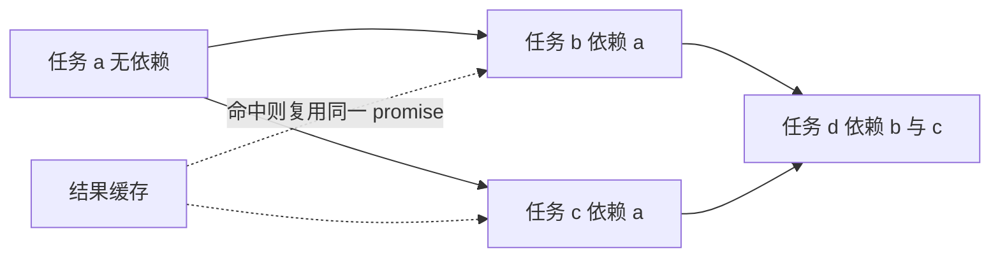

## JS-094：如何用 Promise 实现顺序依赖的 DAG 任务执行？

**答**：
- DAG：任务间有依赖关系但无环，被依赖者先完成，依赖者拿到它们的输出再执行。
- 关键技巧：递归 + Promise 缓存，每个节点的 Promise 只创建一次，被多个后继共享。
- `Promise.all(deps.map(exec))` 并行等待所有前置，天然让无依赖的分支并行。
- 缓存的是 Promise 而不是值，避免并发触发时重复执行同一任务。



```javascript
const sleep = (ms) => new Promise((r) => setTimeout(r, ms));

// 任务图：a 无依赖；b、c 依赖 a；d 依赖 b 与 c
const graph = {
  a: () => sleep(100).then(() => 'A'),
  b: (a) => sleep(50).then(() => `B<-${a}`),
  c: (a) => sleep(80).then(() => `C<-${a}`),
  d: (b, c) => Promise.resolve(`${b} + ${c} => D`),
};

function runDAG(graph, deps) {
  const cache = {}; // 节点名 → 该节点的 Promise（单例）
  const exec = (name) => {
    if (name in cache) return cache[name];
    const p = Promise.all(deps[name].map(exec)) // 并行等待所有前置
      .then((args) => graph[name](...args));    // 前置结果作为参数
    cache[name] = p;
    return p;
  };
  return exec;
}

const deps = { a: [], b: ['a'], c: ['a'], d: ['b', 'c'] };
const exec = runDAG(graph, deps);
const t0 = Date.now();
exec('d').then((res) => console.log(res, `${Date.now() - t0}ms`));
// B<-A + C<-A => D，总耗时约 180ms 而非 230ms（b 与 c 并行）
```
