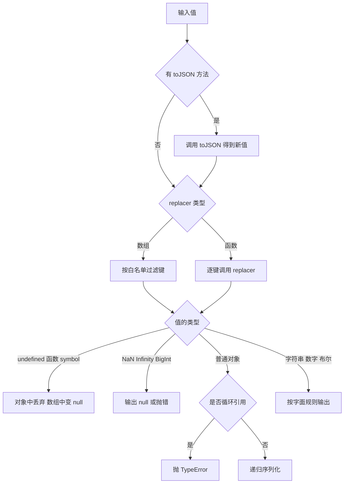

## JS-100：JSON.stringify 的高级用法有哪些？如何检测循环引用？

**答**：
- 处理顺序：toJSON 优先 → replacer 过滤/转换 → 按类型规则输出；undefined、函数、symbol 属性被忽略（数组中变 null）。
- replacer 数组是白名单（只保留指定 key）；replacer 函数对每个键值对调用，返回 undefined 表示丢弃。
- 第三个参数 space 控制缩进；NaN/Infinity 序列化为 null；BigInt 直接抛 TypeError。
- 循环引用原生会抛 TypeError，可在 replacer 里用 WeakSet 记录祖先对象实现“标记后继续”。



```javascript
const data = {
  name: 'x',
  toJSON() { return { name: 'serialized' }; }, // 1. toJSON 优先生效
  secret: Symbol('s'),                          // 2. symbol 属性被忽略
  fn: () => {},                                 // 3. 函数被忽略
  und: undefined,                               // 4. undefined 被忽略
  date: new Date(0),                            // 5. Date 自带 toJSON → ISO 字符串
};

console.log(JSON.stringify(data));
// {"name":"serialized","date":"1970-01-01T00:00:00.000Z"}

// replacer 数组：白名单（toJSON 之后的结果也要有该键）
console.log(JSON.stringify(data, ['name', 'date']));
// {"name":"serialized","date":"1970-01-01T00:00:00.000Z"}

// replacer 函数：首参是 key（根调用为空串），返回 undefined 即丢弃
console.log(JSON.stringify({ a: 1, b: 'hide' }, (k, v) => (k === 'b' ? undefined : v)));
// {"a":1}

// 循环引用检测：WeakSet 记录祖先，遇到重复即标记
function safeStringify(obj, space = 0) {
  const seen = new WeakSet();
  return JSON.stringify(obj, function (key, value) {
    if (typeof value === 'object' && value !== null) {
      if (seen.has(value)) return '[Circular]'; // 也可以直接抛出与原生一致
      seen.add(value);
    }
    return value;
  }, space);
}
const cyc = { self: null, arr: [] };
cyc.self = cyc; cyc.arr.push(cyc);
console.log(safeStringify(cyc)); // {"self":"[Circular]","arr":["[Circular]"]}
```
