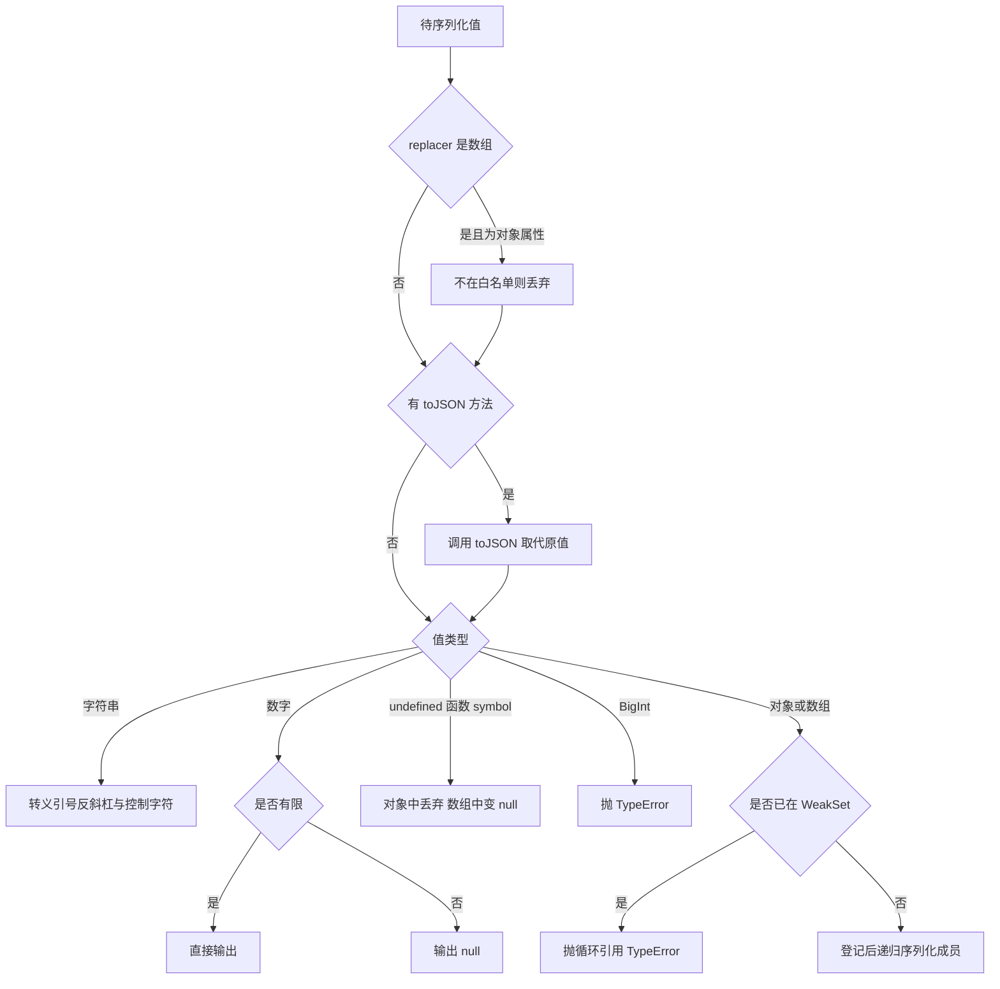

## JS-136：如何手写 JSON.stringify？特殊值如何处理？

**答**：
- 处理顺序与原生一致：replacer → toJSON → 按类型分派输出。
- 类型分派：undefined/函数/symbol 在对象属性中被过滤、在数组中变 null；NaN/Infinity → null；BigInt 抛 TypeError。
- 字符串要转义 `"` `\` 与控制字符；对象/数组递归并用 WeakSet 检测循环引用（与原生一致抛 TypeError）。
- 数组洞与 undefined 元素序列化为 null（这是数组与对象处理的关键差异）。



```javascript
function jsonStringify(value, replacer = null, space = 0) {
  const pad = typeof space === 'number' ? ' '.repeat(space) : typeof space === 'string' ? space : '';
  const seen = new WeakSet();
  const ESC = { '"': '\\"', '\\': '\\\\', '\b': '\\b', '\f': '\\f', '\n': '\\n', '\r': '\\r', '\t': '\\t' };
  const quote = (s) => '"' + s.replace(/["\\\b\f\n\r\t]/g, (ch) => ESC[ch]) + '"';

  function encode(val, key, insideArray) {
    // 1. replacer：数组 = 白名单（仅作用于对象属性，数组元素始终保留）
    if (Array.isArray(replacer) && !insideArray) {
      if (!replacer.includes(key)) return undefined;
    } else if (typeof replacer === 'function') {
      val = replacer(key, val); // 函数 replacer 可改写值，返回 undefined 即丢弃
    }
    // 2. toJSON 优先
    if (val && typeof val.toJSON === 'function') val = val.toJSON(key);

    // 3. 原始类型
    if (val === null) return 'null';
    switch (typeof val) {
      case 'boolean': return String(val);
      case 'string':  return quote(val);
      case 'number':  return Number.isFinite(val) ? String(val) : 'null'; // NaN/Infinity → null
      case 'bigint':
      case 'symbol':
      case 'function':
      case 'undefined':
        return undefined; // 由调用方决定：对象中丢弃 / 数组中变 null
    }

    // 4. 对象与数组：循环引用检测
    if (seen.has(val)) throw new TypeError('Converting circular structure to JSON');
    seen.add(val);
    let body;
    if (Array.isArray(val)) {
      const items = [];
      for (let idx = 0; idx < val.length; idx++) {
        const enc = encode(val[idx], String(idx), true);
        items.push(enc === undefined ? 'null' : enc); // 数组洞/undefined → null
      }
      body = `[${items.join(',')}]`;
    } else {
      const props = [];
      for (const [k, v] of Object.entries(val)) { // 仅自身可枚举字符串键
        const enc = encode(v, k, false);
        if (enc !== undefined) props.push(`${quote(k)}:${enc}`); // undefined 值丢弃
      }
      body = `{${props.join(',')}}`;
    }
    seen.delete(val);
    return body; // space 缩进排版此处从简，核心语义与原生一致
  }
  return encode(value, '', false);
}

console.log(jsonStringify({ a: undefined, b: 2, [Symbol('s')]: 1, fn() {} }));
// {"b":2} — undefined/函数/symbol 键被过滤（symbol 键本就不进 entries）
console.log(jsonStringify([1, undefined, function () {}, NaN]));
// [1,null,null,null] — 数组中全部变 null
console.log(jsonStringify({ d: new Date(0) })); // {"d":"1970-01-01T00:00:00.000Z"} — toJSON
const cyc = {}; cyc.self = cyc;
try { jsonStringify(cyc); } catch (e) { console.log(e instanceof TypeError); } // true
```
