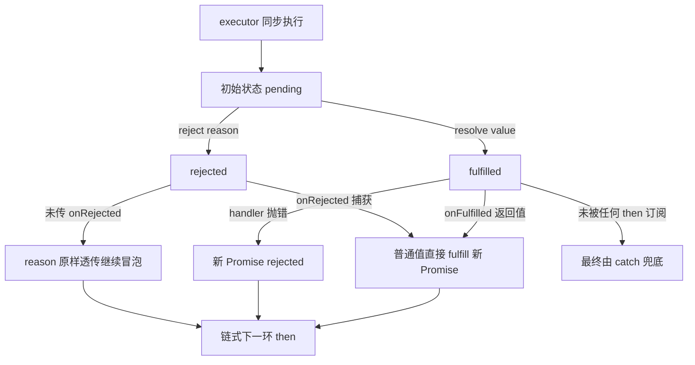

## JS-147：手写 Promise 完整版？then 链、异步 resolve、错误冒泡怎么实现？

**答**：
- 三状态单向流转：pending 只能变成 fulfilled 或 rejected 一次，之后不可再变。
- pending 期间注册的 then 回调进队列，settle 后异步派发（queueMicrotask），保证 then 先注册再回调。
- then 返回新 Promise：onFulfilled 返回值作为新 Promise 的 value，handler 抛错则新 Promise rejected。
- 错误冒泡：没有传 onRejected 时 reason 原样透传给下一环，直到被 catch 接住——这就是链式的核心。
- 本版为可读性省略 thenable 二次展开与 allSettled/all 的完整规范细节，面试补上 all/race 即可加分。



```javascript
const PENDING = 'pending', FULFILLED = 'fulfilled', REJECTED = 'rejected';

class MyPromise {
  constructor(executor) {
    this.state = PENDING;
    this.value = undefined;
    this.callbacks = [];                        // pending 期订阅的 then 回调
    const resolve = (value) => this._settle(FULFILLED, value);
    const reject  = (reason) => this._settle(REJECTED, reason);
    try { executor(resolve, reject); } catch (e) { reject(e); } // executor 同步抛错也走 reject
  }

  _settle(state, value) {
    if (this.state !== PENDING) return;         // 状态一旦定型不可再变
    this.state = state;
    this.value = value;
    queueMicrotask(() => {                      // 异步派发，保证 then 先注册
      const cbs = this.callbacks; this.callbacks = [];
      cbs.forEach((cb) => this._fire(cb));
    });
  }

  _fire({ onFulfilled, onRejected, resolve, reject }) {
    queueMicrotask(() => {
      try {
        const handler = this.state === FULFILLED ? onFulfilled : onRejected;
        if (typeof handler !== 'function') {    // 透传：值透传给下一环 / 错误继续冒泡
          return this.state === FULFILLED ? resolve(this.value) : reject(this.value);
        }
        resolve(handler(this.value));           // 返回普通值 → 新 Promise fulfilled
      } catch (e) { reject(e); }                // handler 抛错 → 新 Promise rejected
    });
  }

  then(onFulfilled, onRejected) {
    return new MyPromise((resolve, reject) => {
      const cb = { onFulfilled, onRejected, resolve, reject };
      this.state === PENDING ? this.callbacks.push(cb) : this._fire(cb);
    });
  }
  catch(onRejected) { return this.then(null, onRejected); }
  finally(fn) {
    return this.then(
      (v) => MyPromise.resolve(fn()).then(() => v),                       // 结果穿透
      (e) => MyPromise.resolve(fn()).then(() => { throw e; })             // 错误穿透
    );
  }
  static resolve(v) { return v instanceof MyPromise ? v : new MyPromise((r) => r(v)); }
  static reject(r)   { return new MyPromise((_, j) => j(r)); }
  static all(list) {
    return new MyPromise((resolve, reject) => {
      const out = []; let left = list.length;
      if (!left) return resolve(out);
      list.forEach((p, i) => MyPromise.resolve(p).then((v) => {
        out[i] = v; if (--left === 0) resolve(out); // 按原顺序收集
      }, reject));                                   // 任一失败立即 reject
    });
  }
  static race(list) {
    return new MyPromise((resolve, reject) => {
      list.forEach((p) => MyPromise.resolve(p).then(resolve, reject)); // 谁先定型用谁
    });
  }
}

// 验证：异步 resolve + then 链 + 错误冒泡 + catch 兜底
new MyPromise((resolve) => {
  setTimeout(() => resolve(1), 100);              // 异步 resolve：then 先注册、后派发
})
  .then((v) => { console.log('then1', v); return v + 1; })
  .then((v) => { console.log('then2', v); throw new Error('boom'); })
  .catch((e) => { console.log('catch', e.message); return 'recovered'; }) // 冒泡被接住
  .finally(() => console.log('finally'))
  .then((v) => console.log('then3', v));
// 输出：then1 1 → then2 2 → catch boom → finally → then3 recovered
```
