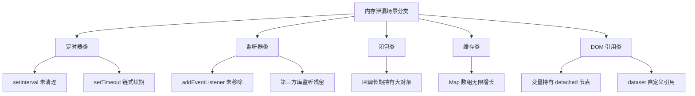

## JS-178：内存泄漏全场景清单与检测方法？定时器、监听器、闭包、缓存、DOM 引用怎么系统性排查？

**答**：
- 泄漏本质 = "不再需要的对象仍被 GC Root 可达引用持有"，常见根：全局变量、定时器回调、事件监听、闭包、无限增长缓存、被 JS 持有的 detached DOM。
- 五大场景清单：setInterval 忘 clear；addEventListener 后组件卸载未 removeEventListener；闭包长期持有大对象；Map/数组缓存无限增长；DOM 节点已从文档移除但仍被变量引用。
- 检测手段：Chrome DevTools Memory 面板三快照对比法、Allocation Timeline 看分配热点、Performance Monitor 观察 JS Heap Size 与 DOM Nodes 是否阶梯式上涨。
- detached DOM 判别：堆快照按 Constructor 过滤 Detached，看 Retainers 链定位是谁在持有。
- 治理原则：组件卸载统一走 cleanup（useEffect 返回清理函数 / beforeUnmount）；缓存用 WeakMap 或 LRU 限容；定时器与监听器"谁注册谁注销"。



```javascript
// 1. 定时器泄漏：组件销毁未 clear，回调闭包持有整个实例
class Panel {
  start() { this.timer = setInterval(() => this.refresh(), 1000); } // 回调引用 this
  refresh() { /* ... */ }
  stop() { clearInterval(this.timer); }   // 忘调 stop 实例永远可达
}

// 2. 监听器泄漏：window 是常驻 Root，卸载未移除即泄漏
// mount:   window.addEventListener('resize', this.onResize);
// unmount: window.removeEventListener('resize', this.onResize); // 必须成对

// 3. 闭包泄漏：长生命周期回调持有大数组
let bigData = new Array(1e6).fill('x');
document.querySelector('#btn').onclick = () => console.log(bigData.length);
// 修复：只捕获需要的字段
// const len = bigData.length; btn.onclick = () => console.log(len); bigData = null;

// 4. 缓存泄漏：全局 Map 无限增长
const cache = new Map();
function memo(key, val) { cache.set(key, val); } // key 无限增多 → 改 LRU 或 WeakMap

// 5. DOM 引用泄漏：detached 节点被 JS 变量持有
let detached;
function replaceNode() {
  const old = document.body.firstElementChild;
  detached = old;          // 即使 remove 后，节点仍无法回收
  old.remove();
}
// 修复：用完 detached = null；元数据关联改用 WeakMap

// 6. 代码级自检：反复执行疑似泄漏操作，观察堆增量趋势
function leakProbe(name, action) {
  return async (times = 20) => {
    const before = performance.memory.usedJSHeapSize;
    for (let i = 0; i < times; i++) action();
    await new Promise((r) => setTimeout(r, 1500)); // 留时间给 GC
    const after = performance.memory.usedJSHeapSize;
    console.log(name, '堆增量约', Math.round((after - before) / 1024), 'KB');
  };
}
```
