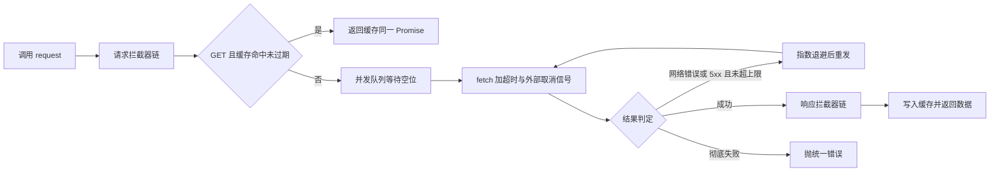

## JS-184：设计一个前端请求库？拦截器、重试、缓存、取消、并发控制如何整合？

**答**：
- 核心是拦截器管道：请求拦截器（注入 token、埋点）→ 发送 → 响应拦截器（统一错误解包、数据裁剪、401 处理），用链式 await 依次执行即可。
- 重试放传输层：只重试幂等方法上的网络错误与 5xx，指数退避加抖动；4xx 业务错误不重试。
- 取消统一走 AbortSignal：超时与业务竞态取消共用一个 AbortController，外部 signal 与内部超时信号级联。
- 缓存放业务层：GET 按 method+url+params 生成 key，命中未过期缓存直接返回同一 Promise，天然防止并发重复请求（防击穿）。
- 并发控制复用队列思想：超过最大并发数的任务排队，前一个完成自动放行下一个。



```javascript
// 1. 骨架：拦截器数组 + 简易并发门
function createHttp(defaults = {}) {
  const reqInterceptors = [];
  const resInterceptors = [];
  const cache = new Map();                       // key -> { promise, expireAt }
  let active = 0; const waiting = [];
  const gate = (fn) => new Promise((res, rej) => {  // 超过并发上限则排队
    waiting.push(() => fn().then(res, rej));
    pump();
  });
  function pump() {
    while (active < (defaults.concurrency ?? 6) && waiting.length) {
      active++;
      waiting.shift()().finally(() => { active--; pump(); });
    }
  }
  const request = (config) => gate(() => run(config));

  // 2. 执行层：拦截器链 → 缓存命中判断
  async function run(config) {
    for (const it of reqInterceptors) config = await it(config);
    const method = (config.method || 'GET').toUpperCase();
    const key = method + ' ' + config.url + ' ' + JSON.stringify(config.params ?? config.data ?? '');
    if (method === 'GET' && config.cacheTTL) {
      const hit = cache.get(key);
      if (hit && hit.expireAt > Date.now()) return hit.promise; // 并发重复请求共享同一 Promise
      if (hit) cache.delete(key);
      const promise = sendWithRetry(config).then(async (raw) => {
        let resp = raw;
        for (const it of resInterceptors) resp = await it(resp); // 响应拦截器
        return resp;
      });
      cache.set(key, { promise, expireAt: Date.now() + config.cacheTTL });
      try { return await promise; }
      catch (e) { cache.delete(key); throw e; }   // 失败不缓存，下次重试
    }
    const raw = await sendWithRetry(config);
    let resp = raw;
    for (const it of resInterceptors) resp = await it(resp);
    return resp;
  }

  // 3. 重试：仅网络错误与 5xx，指数退避 + 抖动
  async function sendWithRetry(config, attempt = 0) {
    try {
      return await doFetch(config);
    } catch (err) {
      const retriable = !err.isBusiness4xx && attempt < (config.retry ?? 0);
      if (!retriable) throw err;
      const delay = Math.min(2 ** attempt * 500, 5000) + Math.random() * 300;
      await new Promise((r) => setTimeout(r, delay));
      return sendWithRetry(config, attempt + 1);
    }
  }

  // 4. fetch：超时与外部取消统一级联到一个 AbortController
  async function doFetch(config) {
    const ctrl = new AbortController();
    const timer = setTimeout(() => ctrl.abort(new Error('timeout')), config.timeout ?? 15000);
    config.signal?.addEventListener('abort', () => ctrl.abort(config.signal.reason));
    try {
      const resp = await fetch(config.url, { ...config, signal: ctrl.signal });
      if (!resp.ok) {
        const e = new Error('HTTP ' + resp.status);
        e.status = resp.status;
        e.isBusiness4xx = resp.status < 500;
        throw e;
      }
      return resp.json();
    } finally { clearTimeout(timer); }
  }

  request.interceptors = {
    request: { use: (fn) => reqInterceptors.push(fn) },
    response: { use: (fn) => resInterceptors.push(fn) },
  };
  return request;
}

// 5. 使用：token 注入 + 业务码解包 + GET 缓存 + 自动重试
const http = createHttp({ timeout: 5000, concurrency: 4 });
http.interceptors.request.use((cfg) => ({
  ...cfg,
  headers: { ...cfg.headers, Authorization: 'Bearer ' + localStorage.getItem('token') },
}));
http.interceptors.response.use((data) =>
  data.code === 0 ? data.result : Promise.reject(data),
);
// http({ url: '/api/list', params: { page: 1 }, retry: 2, cacheTTL: 30_000 })
```
