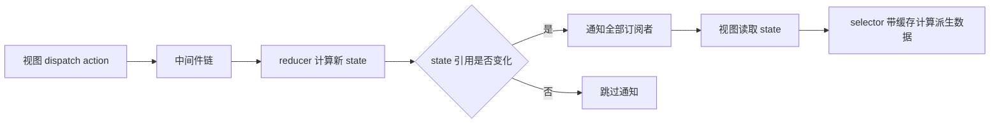

## JS-185：设计一个状态管理库？订阅、派生、中间件如何用 100 行实现？

**答**：
- 核心 = 单一 store：state 不允许直接改，dispatch(action) 经 reducer 产生新 state；reducer 返回原引用则跳过通知，天然做变更粒度优化。
- 订阅：listeners 用 Set 存储，subscribe 返回 unsubscribe；通知在 dispatch 内 state 确定后同步触发，保证视图拿到最终 state。
- 派生状态（selector）带一级缓存：输入引用没变直接复用上次结果，避免昂贵的 filter/map 在每次 render 重复执行。
- 中间件：applyMiddleware 用 reduceRight 把原 dispatch 包在链最内层，日志、thunk 异步、上报等横切能力可插拔。
- 100 行覆盖 Redux 精髓：getState / dispatch / subscribe / applyMiddleware / createSelector。



```javascript
// 1. createStore：reducer + 订阅通知
function createStore(reducer, preloadedState) {
  let state = preloadedState;
  const listeners = new Set();
  const getState = () => state;
  function dispatch(action) {
    if (typeof action.type === 'undefined') throw new Error('action 缺少 type');
    const next = reducer(state, action);
    if (next !== state) { state = next; listeners.forEach((fn) => fn()); } // 引用变才通知
    return action;
  }
  const subscribe = (fn) => (listeners.add(fn), () => listeners.delete(fn));
  return { getState, dispatch, subscribe };
}

// 2. applyMiddleware：原 dispatch 位于链最内层
function applyMiddleware(store, ...mws) {
  let dispatch = store.dispatch;
  const api = { getState: store.getState, dispatch: (a) => dispatch(a) };
  const chain = mws.map((mw) => mw(api));
  store.dispatch = chain.reduceRight((next, mw) => mw(next), dispatch);
  return store;
}

// 3. 两个经典中间件：日志 + 异步 thunk
const logger = () => (next) => (action) => {
  console.log('[dispatch]', action);
  return next(action);
};
const thunk = ({ dispatch, getState }) => (next) => (action) =>
  typeof action === 'function' ? action(dispatch, getState) : next(action);

// 4. 派生状态：一级缓存的 selector
function createSelector(selector, compute) {
  let lastInput = Symbol('none'), lastResult;
  return (state) => {
    const input = selector(state);
    if (input !== lastInput) { lastResult = compute(input); lastInput = input; }
    return lastResult;
  };
}

// 5. 组装：todo store 完整示例
const reducer = (state = { todos: [], filter: 'all' }, action) => {
  switch (action.type) {
    case 'todo/add':   return { ...state, todos: [...state.todos, action.payload] };
    case 'filter/set': return state.filter === action.payload ? state : { ...state, filter: action.payload };
    default:           return state;
  }
};
const store = applyMiddleware(createStore(reducer), logger, thunk);

const visibleTodos = createSelector(
  (s) => s.filter === 'all' ? s.todos : s.todos.filter((t) => t.done === (s.filter === 'done')),
  (list) => list.map((t) => ({ ...t, label: t.text.toUpperCase() })), // 昂贵变换，输入不变不重算
);
store.subscribe(() => render(store.getState()));
function render(state) { console.log('渲染', visibleTodos(state)); }

store.dispatch({ type: 'todo/add', payload: { text: '学习', done: false } });
store.dispatch({ type: 'filter/set', payload: 'done' });
// 异步 action 示例：thunk 放行函数
store.dispatch(async (dispatch) => {
  const data = await fetch('/api/init').then((r) => r.json());
  dispatch({ type: 'todo/add', payload: data.firstTodo });
});
```
