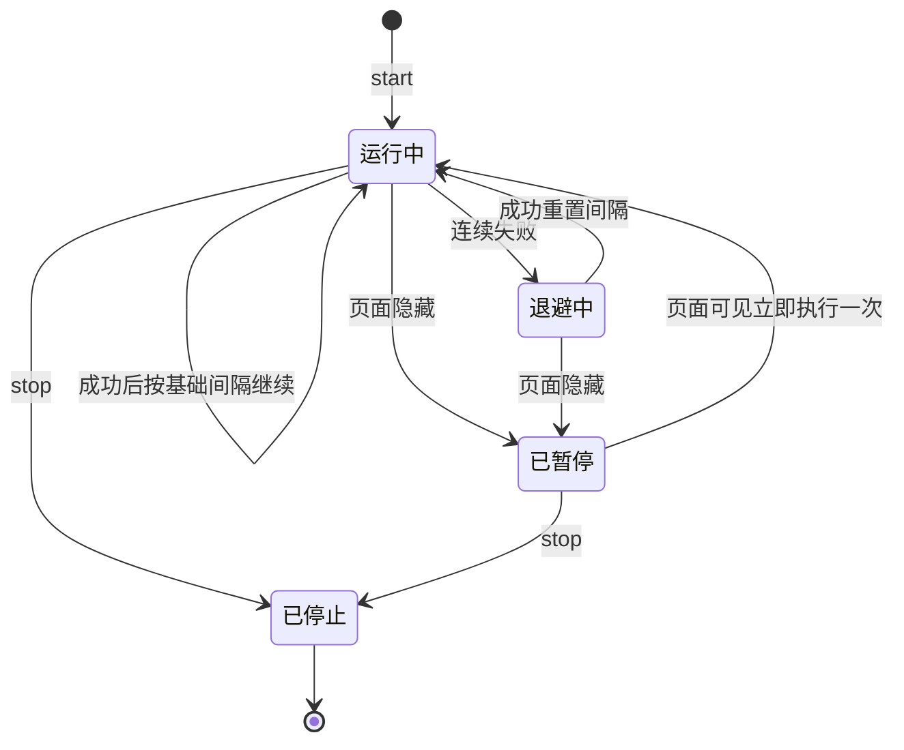

## JS-197：设计一个轮询管理器？可视性感知、指数退避、恢复怎么做？

**答**：
- 基础轮询用递归 setTimeout 而不是 setInterval：避免请求堆积重叠与间隔漂移，单次请求带超时与 AbortController 可取消。
- 指数退避：连续失败把间隔按 2^n 拉长（加随机抖动防雪崩），封顶 maxInterval；成功一次即重置回基础间隔。
- 可视性感知：document.hidden 时暂停排程，visibilitychange 恢复可见立即执行一次再继续，省流量省电。
- 生命周期：start 幂等、stop 清定时器并 abort 在途请求；task 抛 AbortError 视为主动停止不算失败。
- 与 WebSocket 的边界：低频状态类用轮询（简单、无连接维护成本）；高频实时类用长连接。



```javascript
// 1. 轮询管理器：可视性感知 + 指数退避 + 可取消
function createPoller(task, { interval = 5000, maxInterval = 60_000, immediate = true } = {}) {
  let timer = null, stopped = true, fails = 0, ctrl = null;

  function currentInterval() {                       // 退避间隔：指数增长 + 抖动，封顶
    const base = Math.min(interval * 2 ** fails, maxInterval);
    return base * (0.8 + Math.random() * 0.4);       // 抖动防多客户端同步请求
  }
  async function tick() {
    if (stopped) return;
    ctrl = new AbortController();
    try {
      await task(ctrl.signal);                       // 任务自己负责超时
      fails = 0;                                     // 成功重置退避
    } catch (e) {
      if (e.name === 'AbortError') return;           // 主动停止不算失败
      fails = Math.min(fails + 1, 10);
      console.warn('轮询失败，下次间隔', Math.round(currentInterval()), 'ms');
    }
    schedule();
  }
  function schedule() {
    if (stopped || document.hidden) return;          // 隐藏时不排新任务
    timer = setTimeout(tick, currentInterval());
  }
  function onVisible() {
    if (!stopped && document.visibilityState === 'visible') {
      clearTimeout(timer);
      immediate ? tick() : schedule();               // 恢复可见：立即刷一次
    }
  }
  document.addEventListener('visibilitychange', onVisible);

  return {
    start() { if (stopped) { stopped = false; tick(); } },
    stop() { stopped = true; clearTimeout(timer); ctrl?.abort(); },
  };
}

// 2. 使用：轮询任务进度，失败自动退避，切后台暂停、回前台刷新
const poller = createPoller(async (signal) => {
  const resp = await fetch('/api/task/1/progress', { signal });
  if (!resp.ok) throw new Error('HTTP ' + resp.status);
  const { percent } = await resp.json();
  console.log('进度', percent);
  if (percent >= 100) poller.stop();
}, { interval: 2000, maxInterval: 30_000 });
poller.start();
```
