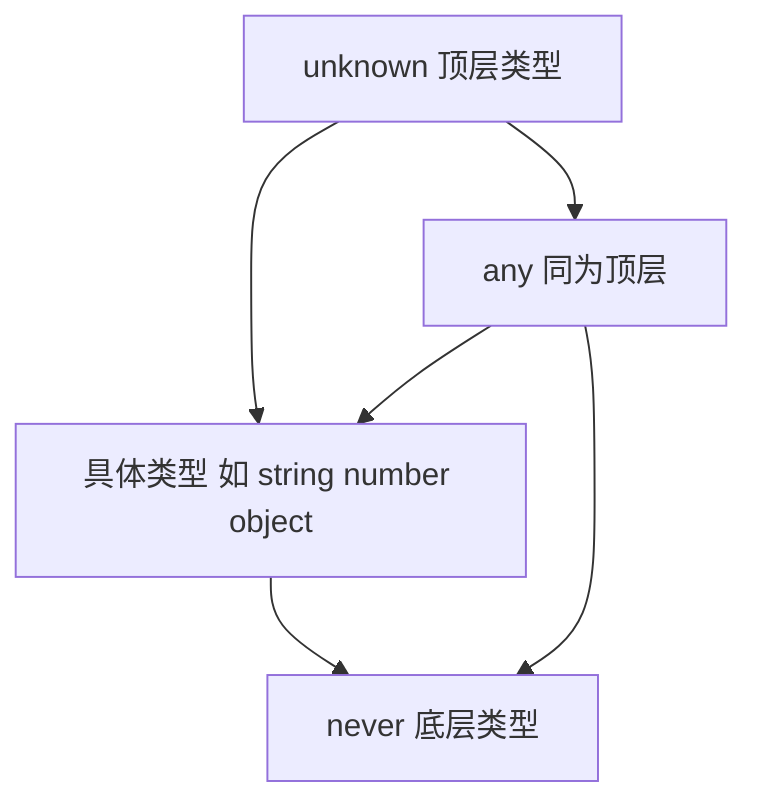

## TS-008：strictNullChecks 开启后带来什么变化？
**答**：
- 开启后 `null` 和 `undefined` 不再能赋给其他类型，每个类型默认不含空值。
- 可选属性、可选参数的类型会自动带上 `undefined`。
- 使用可能为空的值必须先收窄：if 判断、可选链 `?.`、空值合并 `??`。
- 这是 `strict` 家族中对运行时安全收益最大的选项。

```typescript
let name1: string = "Tom";
// name1 = null; // 报错：string 不含 null

function findUser(id: number): { name: string } | null {
  return id === 1 ? { name: "Tom" } : null;
}

const user = findUser(1);
// user.name; // 报错：user 可能为 null
if (user) {
  console.log(user.name); // 收窄后安全
}
console.log(user?.name ?? "匿名"); // 可选链 + 空值合并
```

## 第二章 any、unknown 与 never

any 会关闭类型检查，unknown 是安全的任意类型，never 是表示"不可能"的底层类型。三者的可赋值关系如下图。


