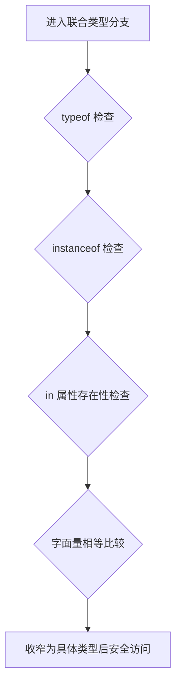

## TS-021：satisfies 操作符解决了什么问题？
**答**：
- `satisfies T` 校验表达式满足类型 T，但不拓宽推断、不改变字面量类型。
- 直接用类型注解 `const x: T = ...` 会把字面量拓宽成宽类型，丢失精确信息。
- 典型场景：配置对象既要校验结构，又要保留每个 key 的字面量类型以便后续精确使用。
- TypeScript 4.9 引入，是"校验"与"推断"兼得的写法。

```typescript
type RouteMap = Record<string, { path: string; auth: boolean }>;

const routes = {
  home: { path: "/", auth: false },
  admin: { path: "/admin", auth: true },
} satisfies RouteMap;

routes.admin.path; // 校验通过，且仍保留精确的字面量信息
// routes.admin.unknownKey; // 报错：多余属性
// routes.bad = {}; // 报错：不满足 RouteMap
```

## 第五章 类型收窄与类型守卫

TypeScript 编译器通过控制流分析把联合类型收窄为更小的类型，常见路径如下图。


