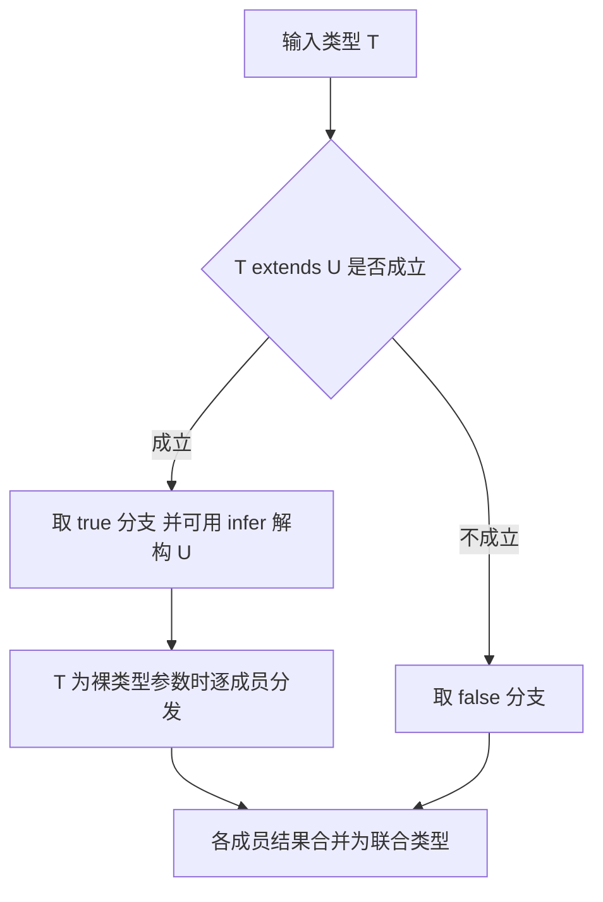

## TS-044：索引访问类型 T[K] 有哪些用法？
**答**：
- `T[K]` 从类型 T 中取出 key K 对应的子类型，K 可以是联合，结果是各子类型的联合。
- 常与 typeof 组合：`typeof ARR[number]` 取数组元素类型、`typeof OBJ[keyof typeof OBJ]` 取值联合。
- 元组支持 `['length']` 取长度字面量类型。
- 可以链式深入：`Person['address']['city']`。

```typescript
const ROLES = ["admin", "editor", "viewer"] as const;
type Role = (typeof ROLES)[number]; // "admin" | "editor" | "viewer"

interface Address {
  city: string;
  zip: string;
}
interface Person {
  name: string;
  address: Address;
}

type City = Person["address"]["city"]; // string
type PersonFields = Person["name" | "address"]; // string | Address

type Pair = [string, number, boolean];
type PairLen = Pair["length"]; // 3（字面量类型）
```

## 第十章 条件类型与 infer

条件类型的求值可以看作一次编译期的分支判断，配合 infer 完成"解构"式的类型提取，整体流程如下。


