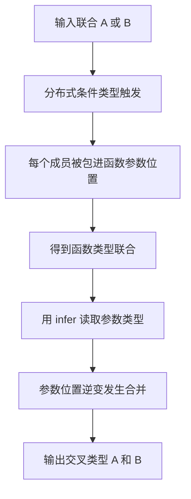

## TS-068：如何手写 UnionToIntersection？为什么需要"二次触发"？
**答**：
- 原理：函数参数位置是逆变的，同一位置的多个参数类型会被 TS 合并成交叉。
- 第一步用分布式条件类型 `U extends any ? (arg: U) => void : never` 把联合的每个成员包进函数参数位置，得到函数类型的联合。
- 第二步用 `infer I` 读取这个函数联合的参数类型，TS 在读取时把参数位置的联合合并为交叉，得到 `U1 & U2 & ...`。
- 陷阱：若传入的联合来自 `keyof` 等需要配合 `[]` 包裹判断 never；分布式是自动发生的，无法关闭，只能用 `[T] extends [X]` 抑制。

```typescript
type UnionToIntersection<U> = (
  U extends any ? (arg: U) => void : never
) extends (arg: infer I) => void
  ? I
  : never;

type A = { a: string };
type B = { b: number };

type Inter = UnionToIntersection<A | B>;
// { a: string } & { b: number }
declare const x: Inter;
x.a; // OK
x.b; // OK

type Members = UnionToIntersection<"a" | "b" | "c">;
// "a" & "b" & "c"（字面量交叉结果为 never，说明互斥）
```



## 第二十章 infer 高阶
