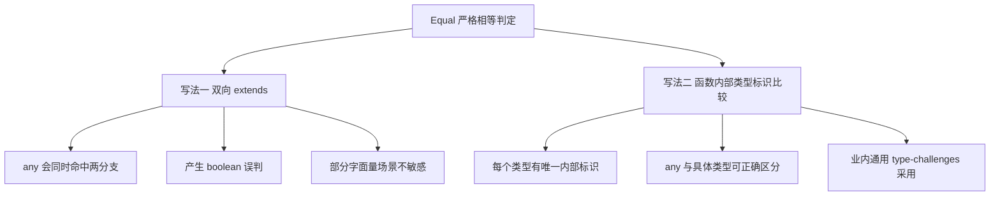

## TS-080：Equal 严格相等判定的多种写法与差异？
**答**：
- 写法一（双向 extends）：`A extends B ? (B extends A ? true : false) : false`，多数情况够用，但对 any、字面量与宽类型、可选属性等场景会误判。
- 写法二（函数内部标识比较）：比较两个泛型函数签名对 T 的解析结果，TS 会为每个类型生成唯一内部标识，只有完全相同的类型标识才一致——这是业内公认的严格相等。
- `any` 是双向 extends 的重灾区：any 会同时命中两个分支产生 boolean 而非 true/false。

```typescript
// 写法一：双向 extends（不严格）
type Equal1<A, B> = A extends B ? (B extends A ? true : false) : false;
type E1a = Equal1<string, string>;            // true，正常
type E1b = Equal1<any, string>;               // boolean（any 分发导致误判！）
type E1c = Equal1<{ a: 1 }, { a: 1; b?: 2 }>; // false，可选属性反向不兼容，尚可

// 写法二：内部类型标识比较（严格，推荐）
type Equal2<X, Y> =
  (<T>() => T extends X ? 1 : 2) extends
  (<T>() => T extends Y ? 1 : 2)
    ? true : false;
type E2a = Equal2<string, string>;  // true
type E2b = Equal2<any, string>;     // false，正确区分 any
type E2c = Equal2<any, any>;        // true
type E2d = Equal2<[1], [1]>;        // true，元组也能正确比较
```


