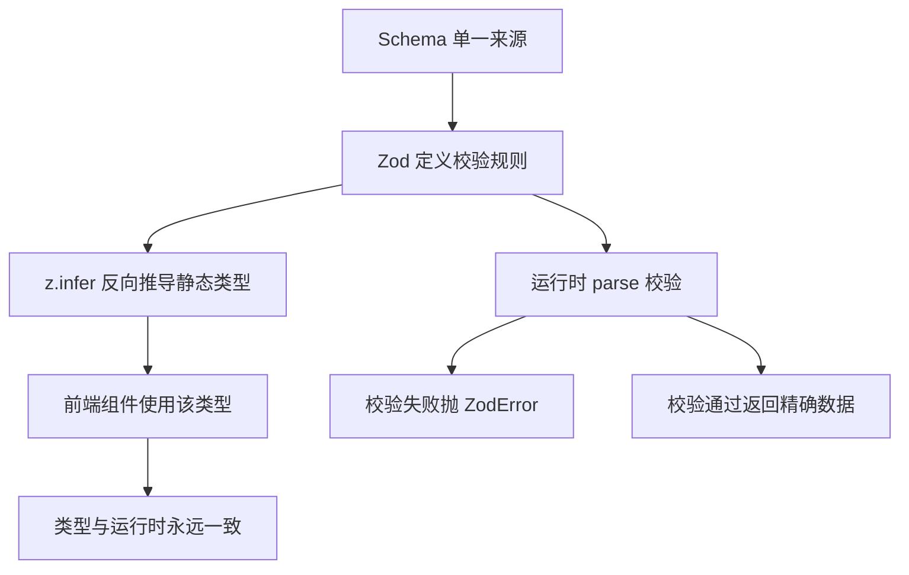

## TS-120：如何用 Zod 让校验 schema 与 TS 类型保持单一来源？
**答**：
- 痛点：手写 interface + 手写校验是双份维护，字段一改两边漂移。
- 方案：只写一份 Zod schema（运行时校验器），用 `z.infer<typeof Schema>` 反推编译期类型，schema 是唯一事实来源。
- Zod parse 在运行时校验失败抛错并给出字段级原因，类型层面永远与校验规则一致；valibot/ajv + JSON Schema 同理。

```typescript
import { z } from "zod";

// 唯一事实来源：schema
const UserSchema = z.object({
  id: z.number().int(),
  name: z.string().min(1).max(20),
  email: z.string().email().optional(),
  role: z.enum(["admin", "user"]),
});

// 编译期类型从 schema 反推，不再手写 interface
type User = z.infer<typeof UserSchema>;
// { id: number; name: string; email?: string; role: "admin" | "user" }

function parseUser(input: unknown): User {
  return UserSchema.parse(input); // 运行时校验 + 返回精确类型
}

try {
  parseUser(JSON.parse('{"id":1,"name":"a","role":"x"}'));
} catch (e) {
  // ZodError：role 非法，字段级报错
}
```


