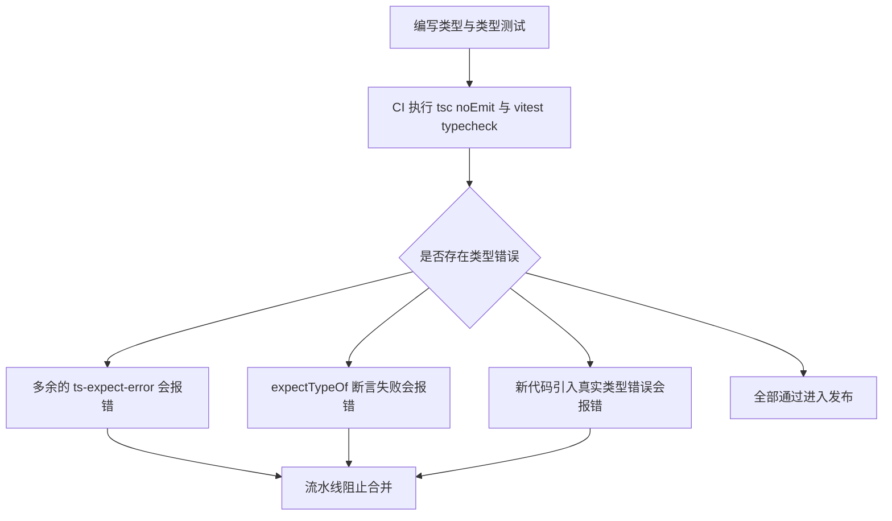

## TS-127：如何做类型测试？@ts-expect-error 的正确用法是什么？
**答**：
- 基础手段：`tsc --noEmit` 全量类型检查进 CI；单测层面用 expect-type / vitest 的 `expectTypeOf` 断言类型相等。
- `@ts-expect-error` 的语义是"下一行必须有错"：如果下一行其实没报错，该注释本身会报错——因此它既是豁免也是断言，优于无限期容忍错误的 `@ts-ignore`。
- 用法纪律：`@ts-ignore` 禁止合入；`@ts-expect-error` 必须附注释说明原因，错误修复后注释会自动"过期报错"，形成闭环。

```typescript
import { expectTypeOf } from "expect-type";

type UnionToIntersection<U> =
  (U extends any ? (arg: U) => void : never) extends (arg: infer I) => void ? I : never;
type IsNever<T> = [T] extends [never] ? true : false;

// vitest + expect-type 的类型断言
expectTypeOf<UnionToIntersection<{ a: 1 } | { b: 2 }>>().toEqualTypeOf<{ a: 1 } & { b: 2 }>();
expectTypeOf<IsNever<never>>().toEqualTypeOf<true>();
expectTypeOf<IsNever<string>>().toEqualTypeOf<false>();

// @ts-expect-error：断言"这行必须报错"
type OnlyString = { tag: "string"; value: string };
function accept(x: OnlyString): void;
// @ts-expect-error 数字字面量不是 string，此处必须报错；修复后此注释会提示未使用的 expect-error
accept({ tag: "string", value: 1 } as never);
```


