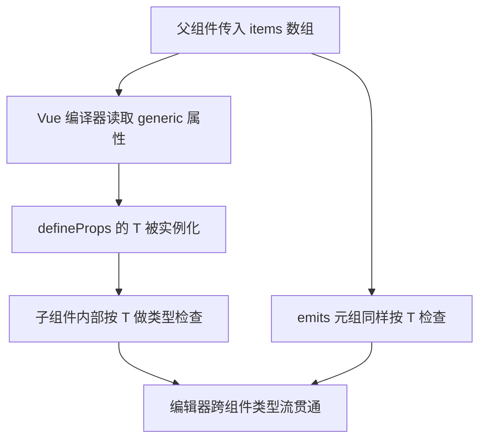

## TS-135：Vue3 泛型组件（script setup 的 generic 属性）怎么写？
**答**：
- Vue 3.3+ 在 `<script setup generic="T extends ...">` 声明类型参数，props/emits 中直接使用 T。
- 父组件使用时由传入的 items 自动实例化 T，实现"数据形状驱动整棵组件类型"。
- 支持多类型参数、约束、默认值；复杂类型可 import 后在 generic 字符串中引用。



```typescript
// List.vue
// <script setup lang="ts" generic="T extends { id: string }">
// defineProps<{ items: T[]; selectedId?: string }>();
// const emit = defineEmits<{ select: [item: T] }>();

// 使用端（由 items 元素类型自动实例化）：
// <List :items="users"  @select="onSelect" />   T 实例化为 User
// <List :items="orders" @select="onSelect" />   T 实例化为 Order

// 多类型参数 + 约束 + 默认值：
// generic="T extends { id: string }, K extends keyof T = keyof T"

// 坑：generic 是字符串形式的类型表达式，语法报错提示较晚；
// 复杂约束建议定义在 types.ts 中 import 进来引用
```
