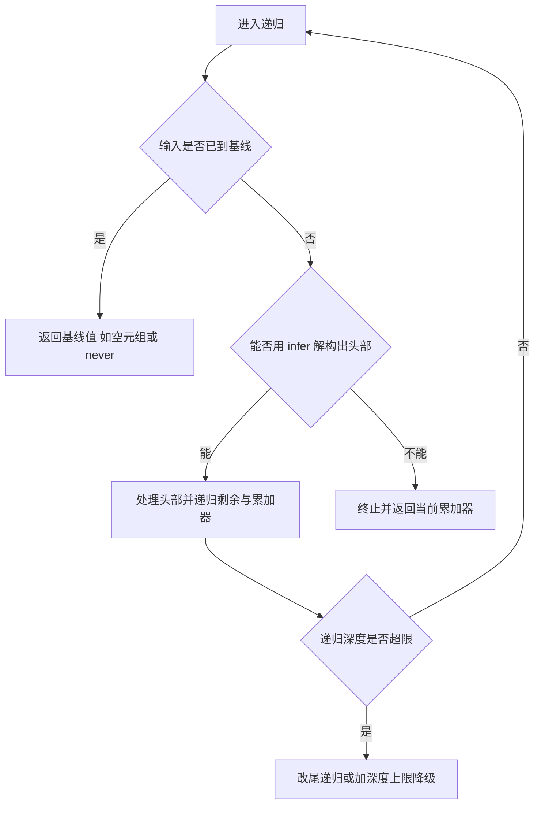

## TS-158：递归类型的终止条件怎么设计？
**答**：
- 三大基线按输入种类定：字符串 `""`、元组 `[]`、联合 `never`；对象递归用"无子对象可下钻"收口。
- 每个分支必须朝基线前进（消耗输入或推进累加器），否则无限递归/爆栈。
- 双递归（同时展开头与剩余）深度消耗翻倍，能改单递归就改单递归。



```typescript
// 三种基线的标准写法
type LenOfString<S extends string, Acc extends unknown[] = []> =
  S extends `${string}${infer R}` ? LenOfString<R, [...Acc, unknown]> : Acc["length"]; // 基线 ""

type ToUnion<T extends unknown[]> = T extends [infer F, ...infer R] ? F | ToUnion<R> : never; // 基线 never

type FlattenDeep<T extends unknown[]> =
  T extends [infer F, ...infer R]
    ? F extends unknown[]
      ? [...FlattenDeep<F>, ...FlattenDeep<R>] // 双递归：深度消耗更快
      : [F, ...FlattenDeep<R>]
    : []; // 基线 []

type L = LenOfString<"abc">; // 3
type U = ToUnion<[1, "a", true]>; // 1 | "a" | true
```
