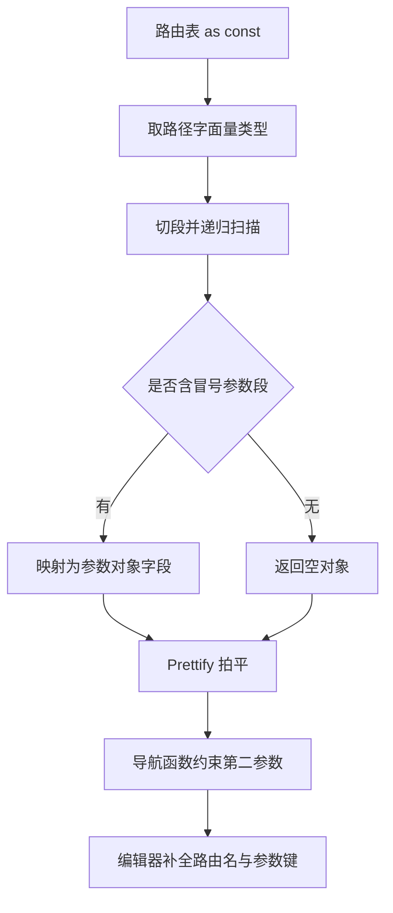

## TS-171：路由如何做到类型安全（params 从路由表推导）？
**答**：
- 路由表 `as const` 是类型源；路径字符串按 "/" 切段，冒号段映射为参数对象字段。
- 导航函数用泛型约束：路由名约束第一参，params 约束第二参，键与必填性全部编译期校验。
- 无参数路由让 params 参数"消失"（条件类型返回空元组），调用更顺手。



```typescript
const ROUTES = {
  home: "/",
  userDetail: "/users/:id",
  userPost: "/users/:id/posts/:postId",
} as const;

type Prettify<T> = { [K in keyof T]: T[K] } & {};
type Split<S extends string> = S extends `${infer A}/${infer B}` ? [A, ...Split<B>] : [S];
type ParamsOf<Segs extends string[]> =
  Segs extends [infer S extends string, ...infer R extends string[]]
    ? S extends `:${infer P}` ? { [K in P]: string } & ParamsOf<R> : ParamsOf<R>
    : {};
type RouteParams<S extends string> = Prettify<ParamsOf<Split<S>>>;

function navigate<S extends keyof typeof ROUTES>(
  name: S,
  ...args: RouteParams<(typeof ROUTES)[S]> extends Record<string, never>
    ? []
    : [params: RouteParams<(typeof ROUTES)[S]>]
) {}

navigate("home");                                // 无参数路由不用传 params
navigate("userDetail", { id: "42" });
// navigate("userPost", { id: "1" });            // 报错：缺 postId
// navigate("nope", {});                         // 报错：路由名不存在
```
