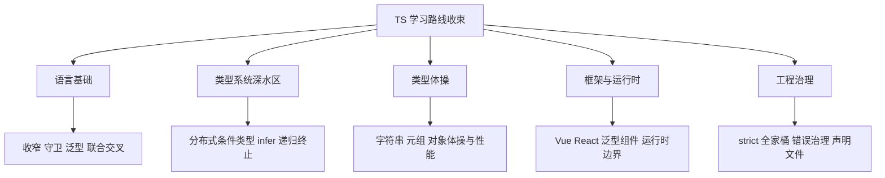

## TS-200：TypeScript 的学习路线如何收束成知识地图？
**答**：
- 六级梯度：会用（L1 基础）→ 会写（L2 手写工具）→ 会想（L3 分布式与递归）→ 会造（L4 体操与组件）→ 会治（L5 工程与治理）→ 压轴（L6 综合大题）。
- 面试考察常见组合：L2 抽 2 题 + L3 抽 1 题 + L4/L5 抽 1 题。
- 体操题先讲思路（终止条件、累加器、复杂度）再落笔，比"直接写对"更被看重。



```typescript
// 知识地图（面试官视角的考察梯度，对应本文件章节）
// L1 会用：基础类型、收窄守卫、泛型约束、内置工具类型      —— TS-001 ~ TS-058
// L2 会写：手写工具类型、infer 提取、可辨识联合建模        —— TS-035 ~ TS-075
// L3 会想：分布式条件类型、Equal/IsUnion、递归终止与性能  —— TS-076 ~ TS-082、TS-158 ~ TS-163
// L4 会造：Chainable/Curry/DeepCamelize/Chunk、泛型组件   —— TS-083 ~ TS-118、TS-150 ~ TS-157
// L5 会治：strict 选项矩阵、错误基线、声明文件、运行时边界 —— TS-119 ~ TS-124、TS-164 ~ TS-187
// L6 压轴：JSON.parse 类型、EventEmitter、ORM select、i18n —— TS-188 ~ TS-199

// 学习顺序建议：
// 1. L1 → L2 逐题手写（不许抄），建立"条件类型直觉"
// 2. L3 先学 Equal/IsNever 两个判断原语，再攻 IsUnion 与递归终止
// 3. L4 结合业务（表格/表单/请求层）落地，别为体操而体操
// 4. L5/L6 面向前冲刺：strict 全家桶 + 两道综合大题限时手写
```
