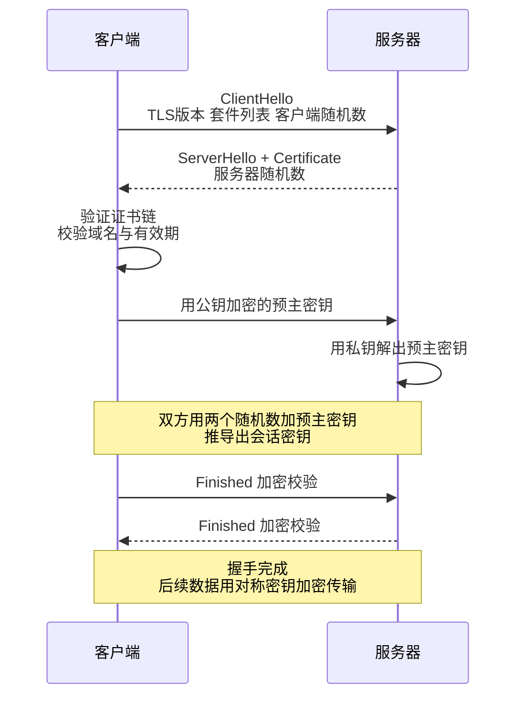

## WEB-012：描述一次完整的 TLS 1.2 握手过程。
**答**：
- ClientHello：客户端发送支持的 TLS 版本、加密套件列表、客户端随机数。
- ServerHello + Certificate：服务器选定套件，返回证书、服务器随机数；（RSA 密钥交换时）可能带 ServerHelloDone。
- 客户端验证证书链后，用公钥加密预主密钥发给服务器；双方用两个随机数 + 预主密钥算出会话密钥。
- 双方互发 Finished（用会话密钥加密的校验值），验证成功后开始加密通信。
- TLS 1.3 把握手压缩到 1-RTT，并废弃了 RSA 密钥交换（不支持前向安全）。

