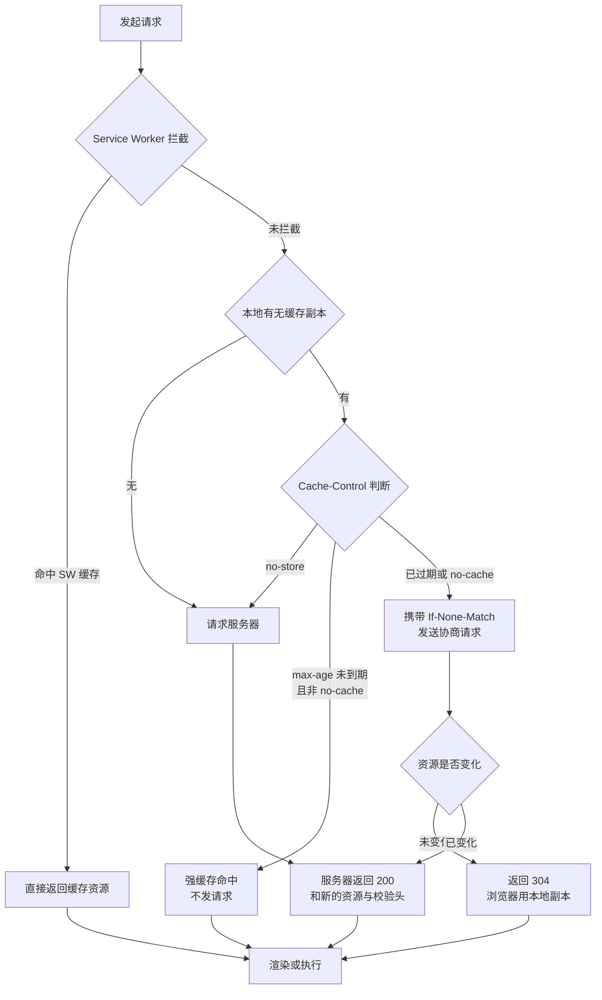

## WEB-024：画出强缓存与协商缓存的完整判定流程。
**答**：
- 浏览器发起请求前先查本地缓存：有缓存且 `max-age` 未到期且非 `no-cache`，直接用（强缓存）。
- 缓存过期或 `no-cache`，带 `If-None-Match`/`If-Modified-Since` 发请求协商：服务器判定未变回 304，变了回 200 + 新资源 + 新校验头。
- `no-store` 直接绕过一切缓存；Service Worker 的 fetch 拦截发生在 HTTP 缓存之前，优先级最高。
- 面试要求能口述流程图并指出"304 省流量不省请求"这个关键差异。

