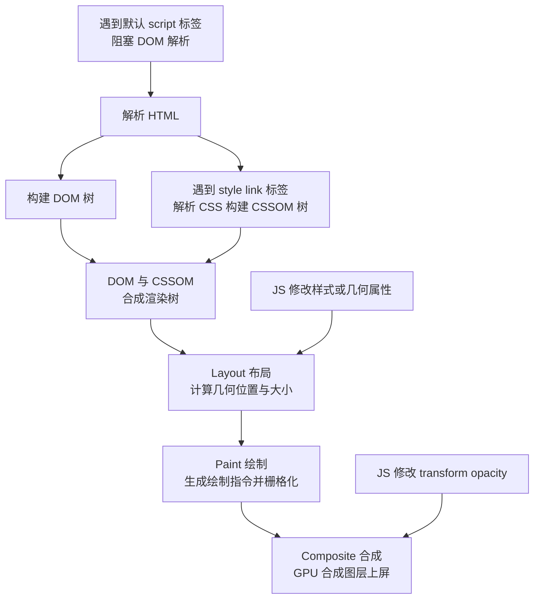

## WEB-048：从输入 URL 到页面渲染，浏览器经历了哪些阶段？
**答**：
- 网络阶段：URL 解析与搜索判定 → DNS → TCP 握手 → TLS → 发送请求、接收响应（中间穿插缓存判断）。
- 渲染阶段：解析 HTML 构建 DOM；解析 CSS 构建 CSSOM；两者合成渲染树。
- 布局（Layout/重排）：计算每个节点的几何位置；绘制（Paint）：填充像素到图层；合成（Composite）：GPU 合成图层上屏。
- JS 会阻塞 DOM 解析（默认 script），CSS 阻塞渲染但不阻塞解析；defer/async 改变脚本执行时机。
- 面试要能画全流程，并指出各阶段的性能优化抓手。

