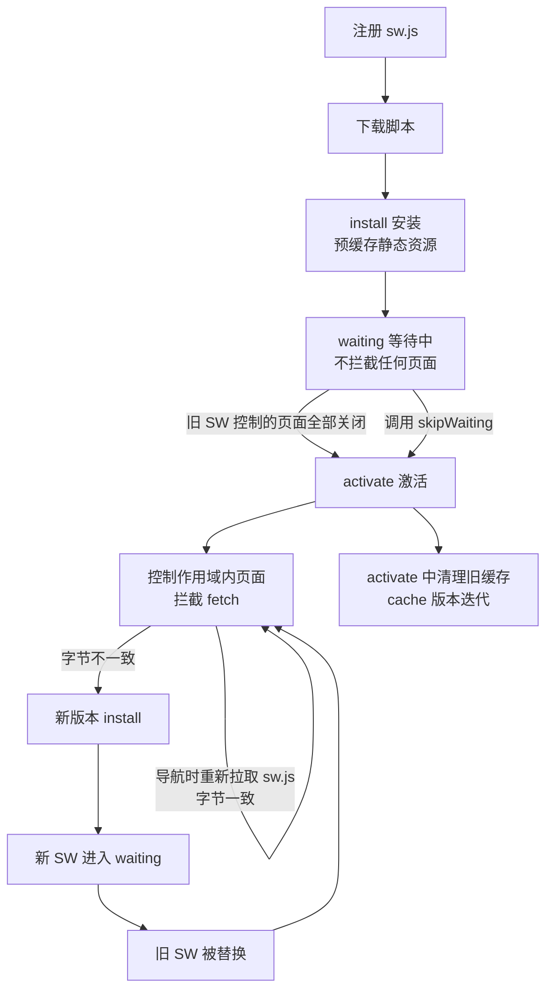

## WEB-058：描述 Service Worker 的生命周期与更新机制。
**答**：
- 生命周期：install（预缓存资源）→ waiting（等待旧 SW 控制的页面关闭）→ activate（清理旧缓存、接管作用域）。
- 更新：浏览器在页面加载/导航时重新拉取 sw.js，字节不同则安装新版本；新 SW 进入 waiting，默认等所有旧页面关闭才 activate。
- 用 `skipWaiting()` 让新 SW 立即接管，配 `clients.claim()` 控制已打开页面；配合前端提示"新版本可用，点击刷新"。
- 注意 sw.js 自身要禁强缓存（`Cache-Control: no-cache`），否则更新检测会延迟。



```javascript
// sw.js：版本化 + skipWaiting 的标准更新流程
const VERSION = 'v3';
const CACHE = `app-${VERSION}`;

self.addEventListener('install', (event) => {
  event.waitUntil(
    caches.open(CACHE).then((c) => c.addAll(['/index.html', '/app.js'])),
  );
  self.skipWaiting(); // 新版本立即接管，配合页面刷新提示
});

self.addEventListener('activate', (event) => {
  event.waitUntil(
    (async () => {
      const keys = await caches.keys();
      await Promise.all(keys.filter((k) => k !== CACHE).map((k) => caches.delete(k)));
      await self.clients.claim(); // 让未刷新的页面也立刻被新 SW 控制
    })()
  );
});
```

```javascript
// 页面侧：检测到新 SW 就提示用户刷新
let refreshing = false;
navigator.serviceWorker.addEventListener('controllerchange', () => {
  if (refreshing) return;
  refreshing = true;
  showUpdateToast(); // "新版本已就绪，点击刷新"
});

navigator.serviceWorker.register('/sw.js').then((reg) => {
  reg.addEventListener('updatefound', () => {
    const nw = reg.installing;
    nw?.addEventListener('statechange', () => {
      if (nw.state === 'installed' && navigator.serviceWorker.controller) {
        showUpdateToast(); // 有旧版本在控制页面时，installed 即代表等待中
      }
    });
  });
});
```
