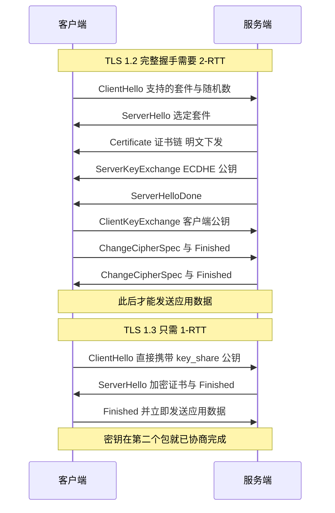

## WEB-072：TLS 1.2 与 TLS 1.3 的握手有什么本质区别？
**答**：
- RTT 差异：TLS 1.2 完整握手需要 2-RTT 才能发应用数据，TLS 1.3 把密钥交换与认证合并，1-RTT 完成，配合 PSK 可 0-RTT。
- TLS 1.3 只保留 AEAD 加密套件，砍掉 RSA 密钥交换、CBC 模式、RC4 等历史包袱，强制前向保密（密钥交换只用 ECDHE/PSK）。
- TLS 1.3 中服务器证书在 ServerHello 后立即加密下发，握手指纹更难被中间设备识别。
- 前端工程关注：1-RTT 意味着 HTTPS 建连成本接近纯 TCP，首屏字节更早到达。



```bash
# 分别用两个版本握手，对比往返信息
openssl s_client -connect example.com:443 -tls1_2 </dev/null 2>/dev/null | grep 'New,'
openssl s_client -connect example.com:443 -tls1_3 </dev/null 2>/dev/null | grep -E 'New,|Cipher is'
```
