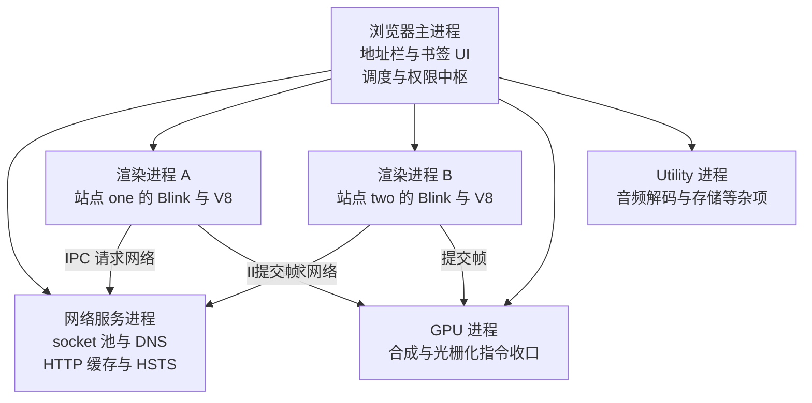

## WEB-082：Chromium 的多进程模型由哪些进程组成？各自负责什么？
**答**：
- 浏览器主进程（Browser）：负责书签/地址栏 UI、网络请求的调度入口、磁盘存储、子进程管理，是唯一有完整系统权限的进程。
- 渲染进程（Renderer）：每个站点（隔离后）一个，跑 Blink 排版引擎与 V8，页面 JS 全部在这里执行。
- GPU 进程：统一负责所有进程的合成与光栅化指令，3D/2D 加速都在此收口。
- 网络服务进程（Network Service）：socket 池、DNS、HTTP 缓存、HSTS 都在这里；另有 Utility 进程承担音频、存储等杂项。
- 设计动机：隔离故障（一个标签崩溃不拖垮浏览器）与隔离权限（渲染进程无权碰网络与文件）。

