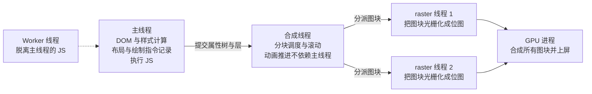

## WEB-084：渲染进程内部的主线程、合成线程、raster 线程各干什么？
**答**：
- 主线程：解析 HTML/CSS、样式计算、布局、记录绘制指令（Paint），跑 JS 与事件循环——一切卡顿源头都在这。
- 合成线程（Compositor）：接收主线程的分层绘制指令（cc 层树），负责滚动/transform 动画的推进与分块调度，不依赖主线程即可工作。
- raster 线程池：把合成线程分派的图块按 GPU 指令真正画成位图，再交给 GPU 进程合成上屏。
- 性能铁律：transform/opacity 动画只走合成器，长任务只阻塞主线程而滚动不卡；JS 频繁操作布局则三线程都要等它。

