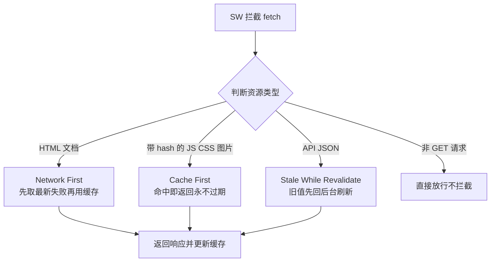

## WEB-099：Service Worker 如何按资源类型组合缓存策略？
**答**：
- 单一策略不够用，工程惯例按类型分流：HTML 走 Network First（保证最新壳）、静态带 hash 资源走 Cache First（永久命中）、API 数据走 Stale-While-Revalidate 或 Network Only。
- HTML 用 Network First 是因为壳文件通常是入口，陈旧会导致引用的 hash 资源 404。
- 预缓存（install 阶段）放 App Shell，运行时缓存（fetch 拦截）放增量资源。
- 版本升级：cache 名带版本号，activate 阶段清掉旧版本缓存。



```javascript
// service-worker.js
const CACHE = 'app-v3';
const SHELL = ['/', '/index.html', '/app.js', '/app.css'];

self.addEventListener('install', (e) => {
  e.waitUntil(caches.open(CACHE).then((c) => c.addAll(SHELL))); // 预缓存 App Shell
});

self.addEventListener('activate', (e) => {
  e.waitUntil(caches.keys().then((keys) =>
    Promise.all(keys.filter((k) => k !== CACHE).map((k) => caches.delete(k))))); // 清旧版本
});

self.addEventListener('fetch', (e) => {
  const req = e.request;
  if (req.method !== 'GET') return;                       // 非 GET 一律放行
  const url = new URL(req.url);

  if (req.mode === 'navigate') {                          // HTML：Network First
    e.respondWith(
      fetch(req).then((res) => {
        const copy = res.clone();
        caches.open(CACHE).then((c) => c.put(req, copy));
        return res;
      }).catch(() => caches.match('/index.html'))
    );
  } else if (/\.(js|css|png|woff2)$/.test(url.pathname)) { // 带 hash 静态资源：Cache First
    e.respondWith(
      caches.match(req).then((hit) => hit || fetch(req).then((res) => {
        const copy = res.clone();
        caches.open(CACHE).then((c) => c.put(req, copy));
        return res;
      }))
    );
  } else if (url.pathname.startsWith('/api/')) {          // API：Stale-While-Revalidate
    e.respondWith(
      caches.open(CACHE).then(async (c) => {
        const hit = await c.match(req);
        const fresh = fetch(req).then((res) => { c.put(req, res.clone()); return res; })
                                .catch(() => hit);
        return hit || fresh;
      })
    );
  }
});
```
