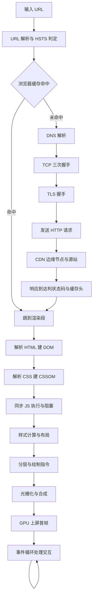

## WEB-124：从输入 URL 到页面渲染的完整 30 步流程，能逐步讲清吗？
**答**：
- 网络段（1-12）：URL 解析补协议 → 缓存查找（memory/disk）→ HSTS 判定 → DNS 缓存递归解析 → TCP 三次握手 → TLS 握手（1.3 一 RTT）→ 构造请求头（Cookie/Accept-Encoding/Sec-Fetch）→ 发送 → 代理/CDN 边缘节点 → 负载均衡到源站 → 服务端处理 → 响应返回（含缓存头与状态码）。
- 渲染段（13-24）：网络栈判缓存 → 移交渲染进程 → HTML 解析建 DOM → 遇 CSS 建 CSSOM → 同步 JS 阻塞解析 → DOM/CSSOM 合成样式树 → Layout 布局树 → 分层 → Paint 记录绘制指令 → 光栅化 → 合成器合成图层。
- 交互段（25-30）：GPU 上屏首帧 → FCP/LCP 采集 → 注册事件监听 → 事件循环处理任务与宏微任务 → 滚动/动画走合成器 → 持续的请求与实时通信维持页面活性。
- 收束话术：每一段都能下钻——网络段可考握手与缓存，渲染段可考关键路径，交互段可考事件循环。



```javascript
// 用 PerformanceNavigationTiming 把整条链路映射成数据
const n = performance.getEntriesByType('navigation')[0];
const steps = {
  '1-DNS': n.domainLookupEnd - n.domainLookupStart,
  '2-TCP': n.connectEnd - n.connectStart,
  '3-TLS': n.secureConnectionStart ? n.connectEnd - n.secureConnectionStart : 0,
  '4-请求与响应': n.responseEnd - n.requestStart,
  '5-HTML 下载': n.responseEnd - n.responseStart,
  '6-DOM 解析': n.domInteractive - n.responseEnd,
  '7-DOMContentLoaded': n.domContentLoadedEventStart,
  '8-完全加载': n.loadEventStart,
};
Object.entries(steps).forEach(([k, v]) => console.log(k, `${Math.round(v)}ms`));
```
