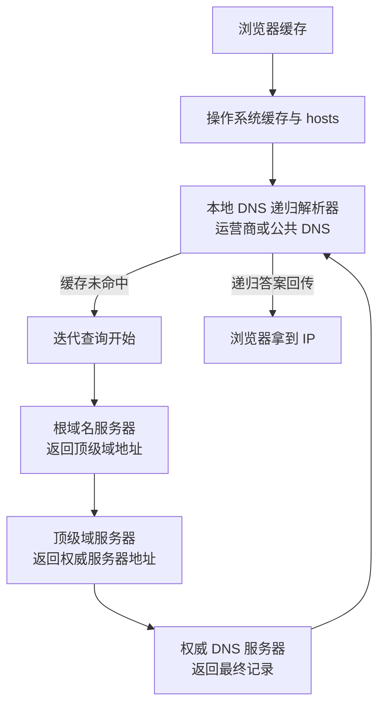

## WEB-131：递归查询和迭代查询的区别是什么？一次解析里谁在递归、谁在迭代？
**答**：
- 递归：客户端把解析责任"打包"给服务器，服务器必须最终给出答案（或明确失败），客户端只等结果。
- 迭代：本地 DNS 向根、顶级域、权威服务器逐级"问路"，每一级只告诉你"下一步去问谁"，不代劳。
- 浏览器到本地 DNS（运营商或公共 DNS）通常是递归；本地 DNS 到层级服务器是迭代。
- 前端感知：浏览器报 DNS_PROBE_FINISHED 时是递归链路断了；用 dig +trace 可模拟一遍迭代路径。
- 缓存命中时整条链路被短路，TTL 内的请求连根服务器都碰不到。



```bash
# 默认模式：向系统配置的 DNS 发起递归查询，flags 里的 rd 表示期望递归、ra 表示服务器支持递归
dig +noall +comments www.example.com | grep flags
# 输出示例 flags: qr rd ra，说明这是一次支持递归的查询
# +trace 手工走一遍迭代链路：从根域逐级打印 NS，直到权威服务器给出 A 记录
dig +trace +nodnssec +noall +answer www.example.com
# 指定公共递归解析器对比解析结果与耗时
dig @223.5.5.5 www.example.com +stats | grep 'Query time'
```
