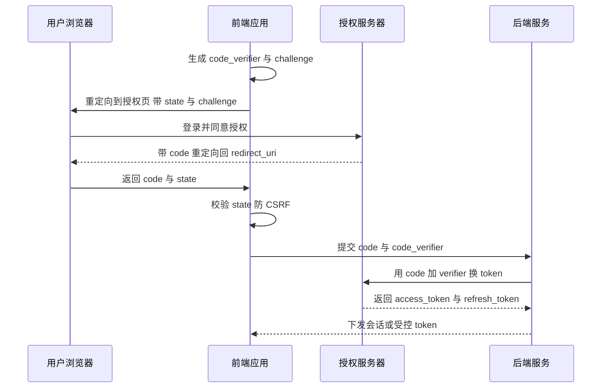

## WEB-146：OAuth 2.0 授权码流程怎么走？PKCE 解决什么问题？
**答**：
- 授权码流程：前端跳授权页 → 用户登录并同意 → 授权服务器带 code 重定向回来 → 后端用 code + client_secret 换 token。
- 关键分工：换 token 需要 client_secret，所以放在后端做；前端只负责发起与接 code，secret 永不出服务器。
- PKCE：公开客户端（无后端的 SPA/App）没有 secret，改用每次随机的 code_verifier 派生 code_challenge，换 token 时带上 verifier 供比对——防止 code 被截获后冒用。
- state 参数防 CSRF（重定向回跳伪造）；redirect_uri 必须精确匹配白名单。



```javascript
// 前端生成 PKCE 参数并发起授权跳转
const verifier = base64url(crypto.getRandomValues(new Uint8Array(32)));
const challenge = base64url(await crypto.subtle.digest('SHA-256', new TextEncoder().encode(verifier)));
sessionStorage.setItem('pkce_verifier', verifier);
const authUrl = new URL('https://auth.example.com/authorize');
authUrl.search = new URLSearchParams({
  response_type: 'code',
  client_id: 'spa-app',
  redirect_uri: 'https://app.example.com/callback',
  scope: 'openid profile',
  state: crypto.randomUUID(),
  code_challenge: challenge,
  code_challenge_method: 'S256',
}).toString();
location.assign(authUrl); // 回调页再把 code 与 verifier 交给后端换 token
```
