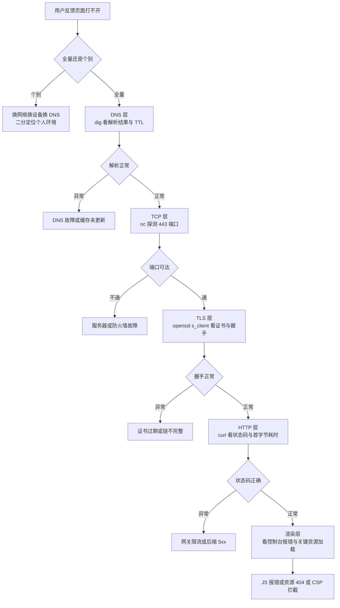

## WEB-190：用户反馈"页面打不开"，给出一次完整的分层排查 SOP。
**答**：
- 按 DNS → TCP → TLS → HTTP → 渲染五层收敛，每层用一条命令拿到证据，避免上来就看业务代码。
- 先判断全量还是个别：换网络（手机热点）、换设备、换 DNS 快速二分，排除个人环境问题。
- 服务端视角补充：网关日志、监控大盘、最近发布记录——很多"打不开"其实是发布回滚造成的。
- 渲染层别漏：HTTP 200 但白屏，要看 JS 报错、关键资源 404、CSP 拦截记录。



```bash
# 每层一条命令拿证据
dig www.example.com +short                       # 1) DNS：有没有解析出 IP
nc -vz -w 3 www.example.com 443                  # 2) TCP：端口是否可达
openssl s_client -connect www.example.com:443 -servername www.example.com </dev/null 2>/dev/null | grep 'Verify return'
                                                 # 3) TLS：证书链校验结果
curl -sS -o /dev/null -w 'code=%{http_code} ttfb=%{time_starttransfer}\n' https://www.example.com
                                                 # 4) HTTP：状态码与首字节耗时
# 5) 渲染：DevTools 的 Console 与 Network，重点看 JS 异常与关键资源是否 404
```
