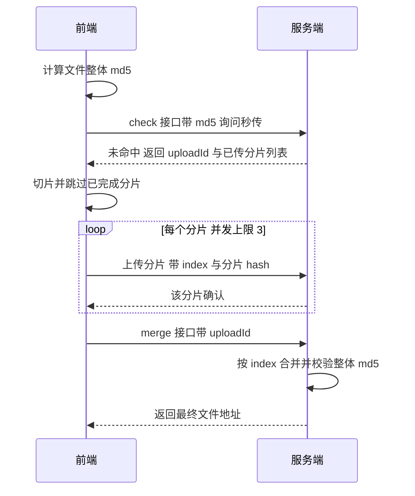

## WEB-192：大文件上传的协议层怎么设计？
**答**：
- 分片：前端按 4-8MB 切片，限并发 3-5 并行上传，每片带 index 与分片 hash；服务端落临时目录。
- 秒传与续传：上传前算文件整体 md5 先询问服务端，已存在直接完成；"已上传分片列表"接口让续传跳过完成部分。
- 合并：全部分片完成后调 merge 接口，服务端按 index 顺序拼接并校验整体 hash；协议骨架是 init/check/chunk/merge 接口组。
- 体验：分片级进度、失败单片重试、暂停与恢复（AbortController + 已传清单）。



```javascript
// 分片上传主流程（秒传 + 断点续传 + 并发控制；hashFile 与 parallel 为工具函数）
async function uploadFile(file) {
  const md5 = await hashFile(file);
  const check = await fetch(`/api/upload/check?md5=${md5}`).then((r) => r.json());
  if (check.exists) return check.url;                     // 秒传
  const uploaded = new Set(check.uploadedChunks);         // 断点续传：跳过已传分片
  const size = 4 * 1024 * 1024;
  const tasks = [];
  for (let i = 0; i * size < file.size; i++) {
    if (uploaded.has(i)) continue;
    tasks.push({ i, blob: file.slice(i * size, (i + 1) * size) });
  }
  await parallel(tasks, 3, async ({ i, blob }) => {       // 限并发 3
    const fd = new FormData();
    fd.append('chunk', blob);
    fd.append('uploadId', check.uploadId);
    fd.append('index', i);
    const res = await fetch('/api/upload/chunk', { method: 'POST', body: fd });
    if (!res.ok) throw new Error(`chunk ${i} failed`);    // 单片失败可单独重试该片
  });
  // 合并：服务端按 index 顺序拼接并校验整体 md5
  return fetch('/api/upload/merge', {
    method: 'POST',
    headers: { 'content-type': 'application/json' },
    body: JSON.stringify({ uploadId: check.uploadId, md5 }),
  });
}
```
